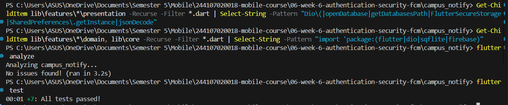
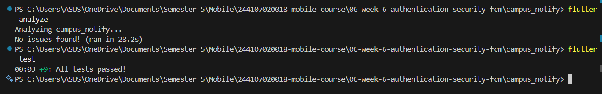
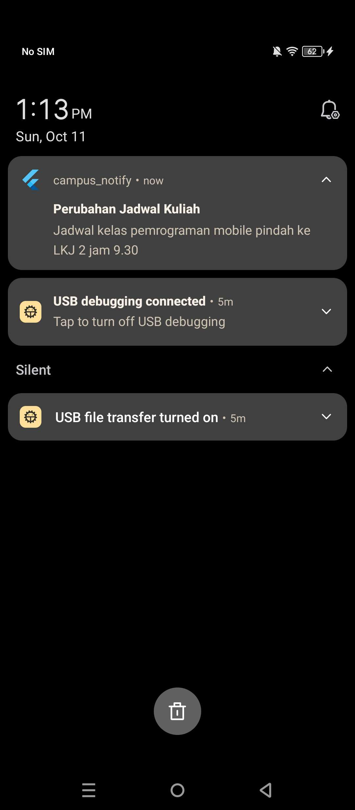
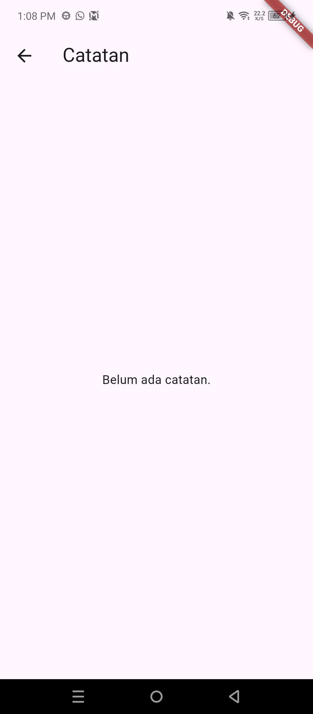
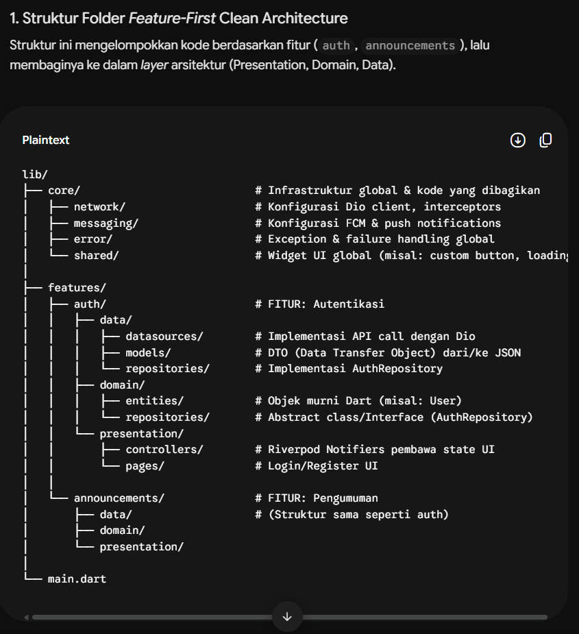
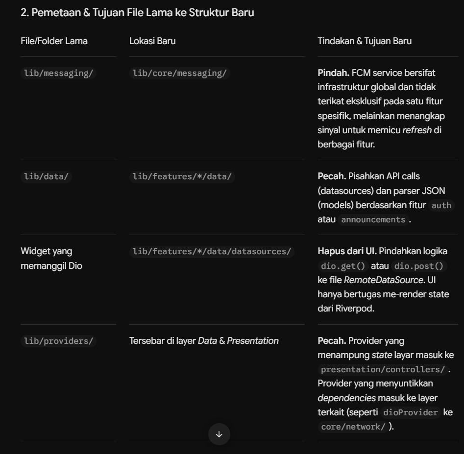
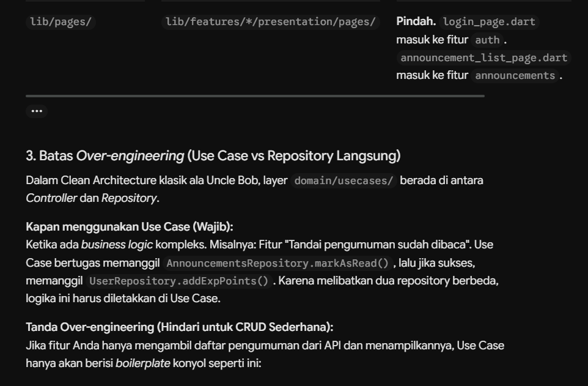
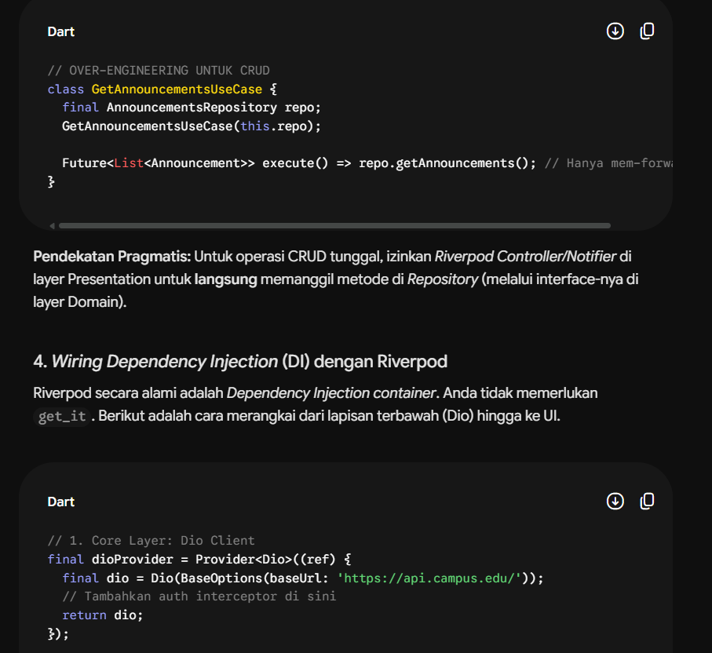
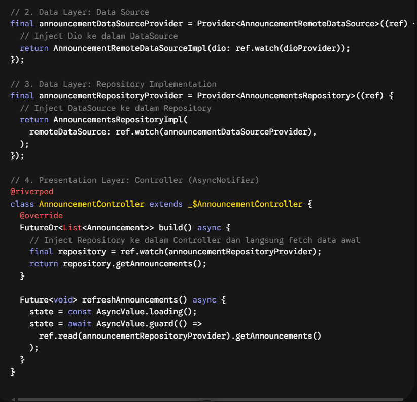
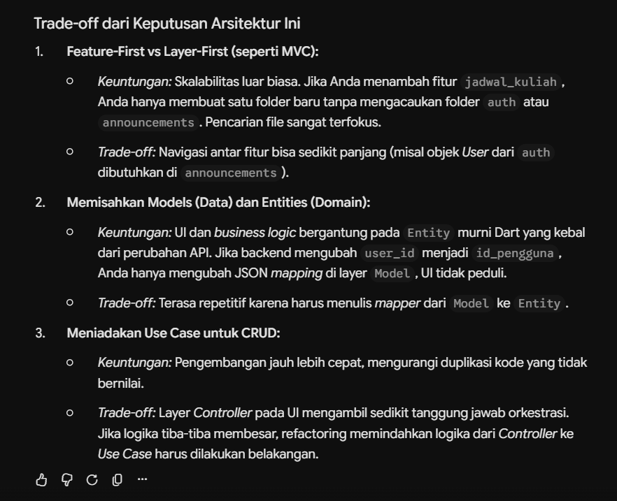

# Week 7 - Authentication, Security & FCM

# Masalah pada week 6
| File | Layer saat ini | Masalah |
|---|---|---|
| `pages/home_page.dart` | presentation | memanggil Dio langsung? memformat tanggal + parsing JSON di widget? |
| `data/api_client.dart` | data | OK bila hanya dipakai repository, bukan widget |
| `providers/auth_provider.dart` | presentation (state) | OK bila hanya memanggil repository/use case |
| `data/auth_repository.dart` | data (+kontrak tercampur) | interface dan implementasi masih satu kelas |

# Campus Notify: Refactor ke Clean Architecture (Feature-First)

## Tujuan Pembelajaran

- Menjelaskan prinsip SOLID dan separation of concerns dengan contoh kode Flutter.
- Membedakan struktur feature-first vs layer-first beserta trade-off-nya.
- Menjelaskan tiga layer (presentation, domain, data) dan aturan dependensi (dependensi mengarah ke dalam).
- Membedakan entity vs model serta peran repository, use case, dan dependency injection.
- Merefactor project Minggu 5/6 menjadi struktur feature-first yang terpisah layer-nya.
- Menguji use case dengan repository palsu tanpa database atau jaringan sungguhan.

## Fitur Utama

- **Login**: autentikasi pengguna dengan penyimpanan token yang aman.
- **Pengumuman**: halaman detail pengumuman yang bisa dibuka dari aplikasi maupun dari notifikasi.
- **Push notification (FCM)**: menampilkan token FCM untuk keperluan debug, menerima notifikasi, dan membuka halaman yang sesuai saat notifikasi diketuk (deep link).
- **Catatan (notes)**: fitur contoh praktikum untuk menerapkan pola Clean Architecture (entity, repository, use case, provider).
- **Navigasi dengan guard**: halaman hanya bisa dibuka setelah login (redirect otomatis).

## Tech Stack

| Kebutuhan | Teknologi |
|---|---|
| Framework | Flutter (Dart) |
| State management & DI | Riverpod (`flutter_riverpod`) |
| Navigasi | GoRouter (`go_router`) |
| HTTP client | Dio |
| Penyimpanan token | `flutter_secure_storage` |
| Notifikasi | Firebase Core & Firebase Messaging |
| Database lokal | `sqflite` + `path` |
| Testing | `flutter_test` |

## Struktur Folder

```text
lib/
├── core/                  # Dart murni: failures.dart, format.dart
├── infrastructures/       # Dio, TokenStore, provider infrastruktur
├── features/
│   ├── auth/              # data + presentation
│   ├── announcements/     # domain + data + presentation
│   ├── home/              # presentation
│   ├── notifications/     # FCM (push_service, route_from_message)
│   └── notes/             # domain + data + presentation
├── routes.dart
└── main.dart
```

Arah dependensi: `presentation → domain ← data`

## Hasil yang Dicapai

- Struktur project berubah dari layer-first (`data/`, `pages/`, `providers/`, `messaging/`) menjadi feature-first.
- Interface repository berada di `domain`, implementasinya di `data`.
- `domain` dan `core` bebas dari import Flutter, Dio, SQLite, dan Firebase (dibuktikan dengan grep, hasil kosong).
- `presentation` bebas dari akses data mentah (Dio, database, JSON); wiring dependency terpusat di file provider.
- Semua error dikonversi menjadi `Failure` dengan pesan ramah pengguna sebelum sampai ke UI.
- Fungsi murni untuk format tanggal dan parsing rute ada di `core/format.dart` sehingga bisa diuji tanpa widget.
- Use case diuji dengan repository palsu (`FakeNoteRepository`) tanpa database atau jaringan.
- `flutter analyze` bersih dan `flutter test` lulus.
- Fitur lama (login, pengumuman, token FCM, deep link notifikasi) tetap berjalan seperti sebelum refactor.

## Verifikasi

| Pemeriksaan | Hasil |
|---|---|
| Presentation bebas data mentah, Domain dan core bebas framework/package  |  |
| `flutter analyze` dan `flutter test` |  |
|Mencoba fitur notifikasi|  |
|Mencoba fitur catatan| |

## AI Prompt Challenge 

**Prompt:** 
```
Project Flutter saya: campus_notify (auth + FCM + daftar pengumuman).
Kondisi kini: folder lib/{data, providers, pages, messaging},
repository tercampur dengan implementasi, widget memanggil Dio langsung.
Tugas:
1. Usulkan struktur feature-first Clean Architecture
   (presentation/domain/data) untuk fitur auth + announcements.
2. Untuk tiap file lama, sebutkan tujuan barunya (pindah/pecah/hapus).
3. Tandai bagian yang over-engineering bila diterapkan ke CRUD sederhana,
   dan kapan use case benar-benar dibutuhkan vs repository langsung.
4. Tunjukkan wiring DI dengan Riverpod (tanpa package DI tambahan).
Jelaskan trade-off setiap keputusan.
```
**Jawaban:**

 
 
 
 
 


## AI Verification Checklist

1.**Apakah interface repository tinggal di `domain` dan implementasi di `data`? (tolak bila AI menaruh keduanya di satu folder)**
 **Lolos.** AI menempatkan interface (abstract class) di `features/*/domain/repositories/` dan implementasinya di `features/*/data/repositories/`, sehingga keduanya terpisah. Di project saya, hal ini sudah diterapkan pada fitur `notes` dan `announcements`: `NoteRepository` dan `AnnouncementRepository` ada di `domain/repositories/`, sedangkan `NoteRepositoryImpl` dan `AnnouncementRepositoryImpl` ada di `data/repositories/`.

---

2.**Apakah `domain` bebas import Flutter/Dio/SQLite/Firebase? Periksa dengan grep, bukan dengan membaca sekilas.**

Usulan AI tidak sepenuhnya lolos, sehingga memutuskan untuk menggunakan hasil pekerjaan saya dari jobsheet saja AI hanya menggambar struktur folder sehingga isi `domain` tidak bisa dinilai dari jawabannya. Selain itu, AI menaruh `core/network/` (Dio) dan `core/messaging/` (FCM) di dalam `core/`, padahal `core/` ikut diperiksa dan harus bebas package luar. Karena itu saya memindahkan file infrastruktur (`api_client`, `api_errors`, `core_providers`, `token_store`) ke `lib/infrastructures/`. Verifikasi dengan grep pada project saya:

```powershell
Get-ChildItem lib\features\*\domain, lib\core -Recurse -Filter *.dart | Select-String -Pattern "import 'package:(flutter|dio|sqflite|firebase)"
```

Hasil:  

tidak ada output (kosong), artinya lolos. Sebelum file dipindah, grep yang sama menemukan 4 file di `lib/core` (`api_client.dart`, `api_errors.dart`, `core_providers.dart`, `token_store.dart`).

---

3.**Apakah AI membuat use case untuk tiap CRUD satu-baris? (itu over-engineering: cukup repository langsung ke notifier, dengan alasan tertulis)**

**Lolos.** AI tidak membuat use case untuk CRUD sederhana. AI menyebut use case sebagai *boilerplate* bila hanya meneruskan satu panggilan (`repo.getAnnouncements()`), dan menyarankan notifier langsung memanggil repository. Use case baru dibutuhkan bila ada logika yang melibatkan beberapa repository atau aturan bisnis. Catatan keputusan saya: pada praktikum, `GetNotes` dan `GetAnnouncement` tetap dibuat sebagai use case karena jobsheet meminta pola lengkap (entity, interface, impl, use case, provider). Sisi positifnya, use case bisa diuji dengan repository palsu tanpa database. Konsekuensinya, kedua use case tersebut hanya berfungsi sebagai pembungkus yang meneruskan satu panggilan ke repository, tanpa logika bisnis tambahan. Untuk aplikasi nyata kurang sesuai kecuali kebutuhan bisnis bertambah.

---

4.**Apakah entity bebas mapping (`toMap/fromMap/toJson` hanya di model)?**

Lolos pada usulan AI, dibuktikan pada project saya. AI menyatakan entity adalah objek murni Dart dan mapping JSON ada di `data/models/`. Pada project saya, `Note` dan `Announcement` tidak memiliki mapping; `toMap/fromMap` ada di `NoteModel` dan `fromJson` di `AnnouncementModel`. Verifikasi:

```powershell
Get-ChildItem lib\features\*\domain\entities -Recurse -Filter *.dart | Select-String -Pattern "toMap|fromMap|toJson|fromJson"
```

Hasil: tidak ada output (kosong).

---

5.Apakah wiring DI terpusat di provider dan widget tidak `new Repository()` sendiri?

Sebagian. AI memang memakai Riverpod sebagai DI, tetapi menyebar provider ke beberapa tempat (`dioProvider` di `core/network`, provider data source dan repository di layer data, controller di presentation). Padahal tujuan wiring adalah satu tempat yang mengenal interface sekaligus implementasi. Selain itu, AI memakai anotasi `@riverpod` yang membutuhkan `riverpod_generator` dan `build_runner`, bertentangan dengan permintaan "tanpa package DI tambahan". Pada project saya, wiring dipusatkan di `presentation/providers/` (`notes_providers.dart`, `announcement_providers.dart`) dengan `Provider` biasa. Verifikasi bahwa widget tidak membuat repository sendiri:

```powershell
Get-ChildItem lib\features\*\presentation -Recurse -Filter *.dart | Select-String -Pattern "RepositoryImpl\(|Repository\("
```

Hasil: tidak ada output (kosong).

---

6.Keputusan final dan alasan teknis Anda, boleh berbeda dari saran AI selama berargumen.


| Usulan AI | Keputusan | Alasan teknis |
|---|---|---|
| Struktur feature-first dengan layer `data/domain/presentation` | **Terima** | Kode satu fitur berada dalam satu folder, mudah ditambah tanpa mengganggu fitur lain. |
| `core/network` dan `core/messaging` berisi Dio dan FCM | **Ubah** | `core/` harus bebas package luar agar grep lolos; infrastruktur dipindah ke `infrastructures/`, FCM ke `features/notifications/`. |
| Tanpa use case untuk CRUD sederhana | **Terima dengan catatan** | Use case hanya meneruskan satu panggilan; tetap dibuat pada praktikum mengikuti jobsheet dan agar mudah diuji. |
| Provider tersebar di beberapa layer | **Tolak** | Wiring dipusatkan di `presentation/providers/` agar hanya satu tempat yang mengenal interface dan implementasi. |
| `@riverpod` dengan code generation | **Tolak** | Menambah dependensi (`riverpod_generator`, `build_runner`), bertentangan dengan syarat tanpa package tambahan. |
| `datasources/` terpisah di bawah repository | **Tolak** | Untuk app sekecil ini, lapisan tambahan belum perlu; repository impl langsung memakai Dio. |
| Memisahkan model (data) dan entity (domain) | **Terima** | Entity kebal terhadap perubahan format API; mapping hanya di model. |

**Kekurangan jawaban AI:** (1) tujuan tiap file lama tidak dipetakan satu per satu, hanya per folder; (2) fitur auth hampir tidak dibahas, termasuk ketergantungan `api_client` dan `auth_repository`; (3) beberapa detail dikarang, seperti URL `https://api.campus.edu/`, contoh `markAsRead + addExpPoints`, dan nama file `announcement_list_page.dart`; (4) ada saran yang tidak relevan, seperti memindahkan pemanggilan Dio dari widget, padahal presentation project saya sudah bebas Dio.

**Arah dependensi:** `presentation → domain ← data`. `domain` tidak bergantung pada layer lain; wiring antar-layer hanya ada di file provider.

## Refleksi

1.**Mengapa interface repository harus tinggal di `domain`, bukan di `data`? Apa yang rusak bila dibalik?**

Interface repository merupakan kontrak yang dibutuhkan oleh logika bisnis (use case). Apabila kontrak tersebut ditempatkan di `data`, maka `domain` harus mengimpor `data` untuk mengenali tipenya. Akibatnya, arah dependensi menjadi terbalik: `domain` bergantung pada `data`, padahal aturan yang berlaku adalah dependensi mengarah ke dalam (`presentation → domain ← data`).

Dampak yang timbul apabila arah dependensi dibalik:

- Domain terikat pada detail teknis. Layer `data` berisi Dio, SQLite, dan pemrosesan JSON. Ketika `domain` mengimpor berkas dari `data`, pustaka-pustaka tersebut ikut menjadi dependensi `domain`, sehingga pemeriksaan grep untuk memastikan `domain` bebas dari Flutter, Dio, SQLite, dan Firebase tidak akan lolos.
- Pengujian menjadi sulit. `GetNotes` tidak dapat diuji menggunakan `FakeNoteRepository` tanpa melibatkan implementasi asli, karena kontraknya berada pada layer yang memuat akses database.
- Penggantian sumber data menjadi sulit. Perpindahan dari SQLite ke API (atau sebaliknya) memaksa perubahan pada kode `domain`, padahal seharusnya cukup dengan menulis implementasi baru di `data`.
- Prinsip SOLID dilanggar, khususnya Dependency Inversion Principle: modul tingkat tinggi (`domain`) seharusnya bergantung pada abstraksi, bukan pada modul tingkat rendah (`data`).

Dengan menempatkan interface di `domain`, layer `data` bertugas memenuhi kontrak yang telah ditetapkan tersebut. Dengan demikian, implementasi dapat diganti tanpa mengubah logika bisnis.

2.**Kapan use case benar-benar dibutuhkan, dan kapan repository langsung ke notifier sudah cukup?**

Use case dibutuhkan ketika ada logika di antara UI dan repository, misalnya:

- Satu aksi melibatkan lebih dari satu repository (contoh: menandai pengumuman dibaca lalu memperbarui data lain).
- Ada aturan bisnis atau validasi (contoh: judul catatan tidak boleh kosong, batas panjang, aturan siapa boleh melakukan apa).
- Logika yang sama dipakai di beberapa tempat (notifier, background task, notifikasi) sehingga perlu satu sumber kebenaran.
- Ada urutan langkah yang harus dijaga (contoh: login, simpan token, lalu daftarkan token FCM).

Repository langsung ke notifier sudah cukup ketika operasinya hanya mengambil atau menyimpan data tanpa aturan tambahan, seperti mengambil daftar pengumuman atau satu pengumuman berdasarkan id. Use case di sini cuma berisi satu baris yang meneruskan panggilan.

3.**Apa biaya over-engineering (use case per CRUD satu-baris) bagi tim kecil? Kapan biayanya sepadan?**

Biaya bagi tim kecil:

- Lebih banyak file dan boilerplate. Satu operasi sederhana menjadi 4 sampai 5 file (entity, interface, impl, use case, provider), padahal logika aslinya satu baris.
- Waktu kerja lebih lama. Menambah satu fitur kecil butuh menyentuh banyak tempat, sehingga kecepatan iterasi turun.
- Beban membaca kode. Anggota baru harus menelusuri beberapa lapisan hanya untuk memahami alur yang sederhana.
- Kompleksitas semu. Struktur terlihat rapi, tetapi tidak ada masalah nyata yang diselesaikan.
- Beban pemeliharaan. Setiap perubahan pada signature repository harus diikuti di use case yang membungkusnya.

**Kapan biayanya sepadan:**

- Aplikasi diperkirakan tumbuh, dengan banyak fitur dan beberapa orang bekerja paralel, sehingga batas layer mengurangi konflik dan efek samping.
- Ada logika bisnis yang kompleks atau sering berubah, sehingga perlu diuji terpisah dari UI dan data.
- Sumber data kemungkinan berganti (lokal ke server, atau beberapa sumber sekaligus).
- Tim mengutamakan pengujian otomatis, karena use case dan repository palsu membuat tes cepat dan stabil.
- Kode akan hidup lama sehingga investasi struktur terbayar saat pemeliharaan.

Untuk prototipe atau aplikasi kecil dengan CRUD sederhana, biaya itu belum sepadan.

4. Bagian mana dari usulan AI yang Anda tolak atau sederhanakan, dan mengapa?

| Usulan AI | Keputusan | Alasan |
|---|---|---|
| `core/network` dan `core/messaging` (Dio dan FCM di dalam `core/`) | **Ubah** | `core/` harus bebas package luar agar grep lolos. Infrastruktur dipindah ke `infrastructures/`, FCM ke `features/notifications/`. |
| Provider tersebar di beberapa layer | **Tolak** | Wiring dipusatkan di `presentation/providers/` supaya hanya satu tempat yang mengenal interface sekaligus implementasi. |
| Anotasi `@riverpod` dengan code generation | **Tolak** | Butuh `riverpod_generator` dan `build_runner`, bertentangan dengan syarat "tanpa package DI tambahan", dan project memakai `Provider` biasa. |
| Lapisan `datasources/` terpisah | **Sederhanakan** | Untuk aplikasi sekecil ini, repository impl yang langsung memakai Dio sudah cukup. Lapisan tambahan baru berguna bila ada beberapa sumber data. |
| Use case hanya untuk logika kompleks | **Terima dengan catatan** | Prinsipnya benar. Pada praktikum use case tetap dibuat mengikuti jobsheet, dengan alasan tertulis di atas. |
| Contoh kode dan data karangan (`https://api.campus.edu/`, `markAsRead + addExpPoints`, `announcement_list_page.dart`) | **Abaikan** | Tidak sesuai dengan project: endpoint, fitur, dan nama file berbeda. |

Selain itu, usulan AI belum membahas auth secara rinci, termasuk ketergantungan `api_client` dan `auth_repository` yang saling membutuhkan. Bagian ini saya putuskan sendiri dan tidak diambil dari usulan AI.