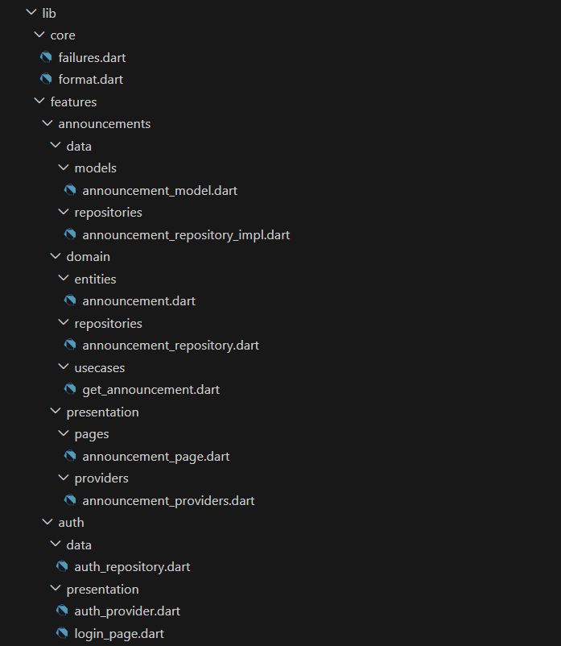
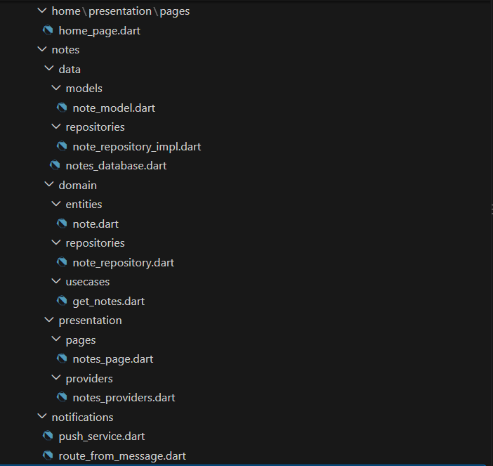
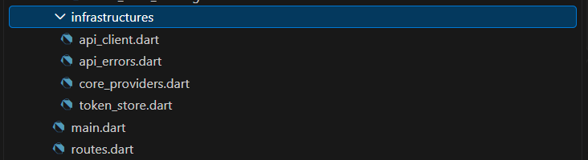
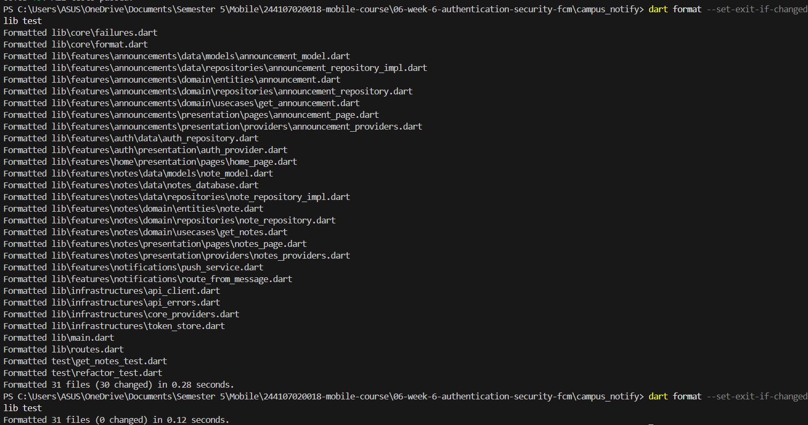
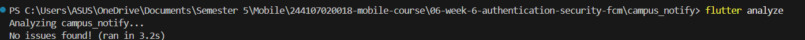
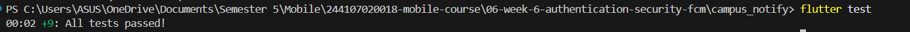
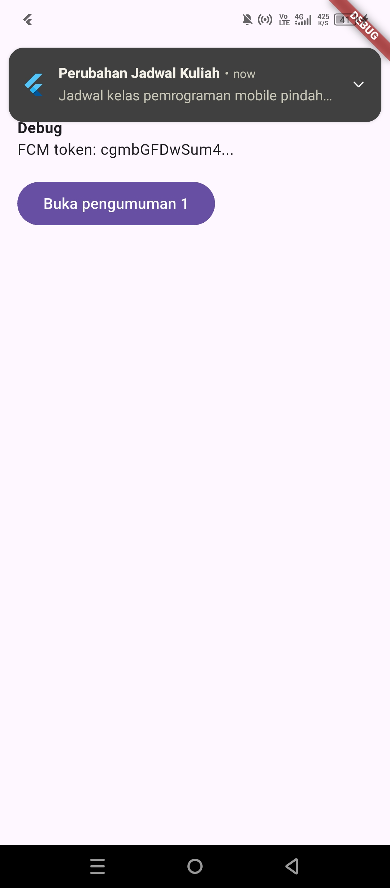
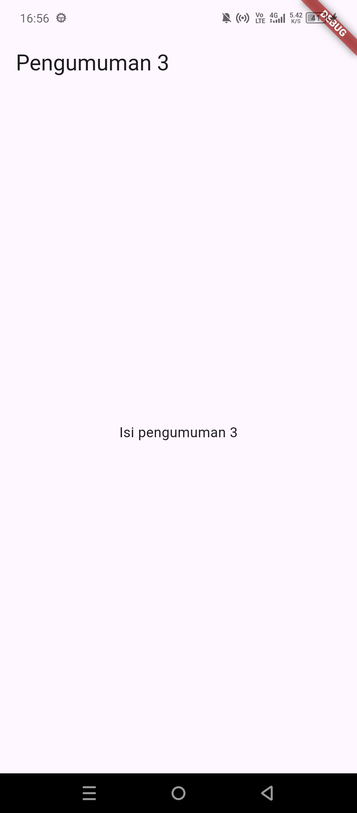

# Week 8 — Mid-Project Review & Pull Request Workflow

# Identitas
| Field  | Isi                     |
|--------|-------------------------|
| Nama   | Muhammad Fattahul Alim  |
| NIM    | 244107020018            |
| Kelas  | TI - 3G                 |
| Absen  | 15                      |

---

# Review Checklist

## 1. Audit Riwayat Git (Praktikum 1, Langkah 1)

Perintah yang dijalankan di root repository (output lengkap: `../screenshots/bukti-audit-git.txt`):

```
git log --oneline -15
git branch -a
git status
```

### Masalah yang ditemukan

| # | Temuan Audit | Bukti |
|---|---|---|
| 1 | Hanya ada branch `main`, belum ada `develop` sebagai target default PR | `git branch -a` → hanya `main` & `origin/main` |
| 2 | Seluruh commit dilakukan langsung ke `main` (tidak ada `feat/*` / `fix/*`) | `git log` 10 commit terakhir semuanya di `main` |
| 3 | Pesan commit non-konvensional: `first commit`, `Menyelesaikan mini project week 5`, `add jobsheet 6 and ...`, `chores: refactor` | `git log --oneline` |
| 4 | Satu commit memuat banyak tujuan sekaligus: `bf55db2` (161 file, +6369) berisi perbaikan laporan, project baru, dan test; `ac6ba6f` (37 file, +535/-128) berisi refactor, fitur baru, test, dan penghapusan file tak terkait | `git show bf55db2 --stat`, `git show ac6ba6f --stat` |
| 5 | Branch lokal tertinggal dari remote dan ada folder yang belum dilacak Git | `git status` → behind `origin/main` by 4 commits; `08-week-8-mid-project-review/` untracked |

## 2. Perbaikan Pesan Commit (Praktikum 1, Langkah 3 — Simulasi)

| Sebelum | Sesudah | Alasan |
|---|---|---|
| `add jobsheet 6 and fix some issue in jobsheet 5 report` (161 file, +6369/-4) | Dipecah jadi 4 commit:<br>1. `docs(week5): perbaiki isi laporan jobsheet 5`<br>2. `feat(campus_notify): tambah project login dan FCM push notification`<br>3. `test(campus_notify): tambah refactor_test`<br>4. `docs(week6): tambah laporan dan screenshot jobsheet 6` | Satu commit memuat perbaikan laporan lama, project baru, test, dan dokumentasi. Setelah dipecah, tiap commit satu tujuan, ukurannya wajar untuk di-review, dan bisa di-revert tanpa merusak yang lain |
| `Menyelesaikan mini project week 5` | `feat(mini-project): selesaikan mini project week 5` | Ada tipe dan lingkup. "Menyelesaikan" saja tidak menjelaskan apa isinya |
| `chores: refactor` (37 file, +535/-128) | Dipecah jadi 5 commit:<br>1. `refactor(campus_notify): ubah struktur ke feature-first (core, features, infrastructures)`<br>2. `feat(notes): tambah layer data, domain, presentation`<br>3. `feat(announcements): tambah layer data, domain, presentation`<br>4. `test(notes): tambah get_notes_test`<br>5. `chore: hapus main.dart praktikum1 week3_navigation yang tidak terpakai` | Tipe `chores` salah (yang benar `chore`) dan tidak menggambarkan isi: ada refactor, fitur baru, test, dan penghapusan file tak terkait dalam satu commit |

## 3. Bukti Struktur Feature-First (Hasil 3 Grep Sterilitas Minggu 7)

Struktur: feature `notes` dan `announcements` punya layer `data/`, `domain/`, `presentation/`.
Semua grep dijalankan dari folder `06-week-6-authentication-security-fcm/campus_notify`, dan memeriksa 6 file `.dart` di folder `domain`.

| # | Aturan | Perintah | Hasil |
|---|---|---|---|
| 1 | `domain` tidak import Flutter SDK | `Get-ChildItem -Path lib\features -Recurse -Filter *.dart \| Where-Object { $_.FullName -match "\\domain\\" } \| Select-String -Pattern "package:flutter/"` | 0 temuan (bersih) |
| 2 | `domain` tidak import layer `data` | `Get-ChildItem -Path lib\features -Recurse -Filter *.dart \| Where-Object { $_.FullName -match "\\domain\\" } \| Select-String -Pattern "/data/"` | 0 temuan (bersih) |
| 3 | `domain` tidak import layer `presentation` | `Get-ChildItem -Path lib\features -Recurse -Filter *.dart \| Where-Object { $_.FullName -match "\\domain\\" } \| Select-String -Pattern "/presentation/"` | 0 temuan (bersih) |

Struktur folder:







## 4. Kualitas Kode

Semua perintah dijalankan dari folder `06-week-6-authentication-security-fcm/campus_notify` yaitu projek yang telah dilakukan refactor pada minggu 7.

| Cek | Perintah | Hasil | Bukti |
|---|---|---|---|
| Format | `dart format --set-exit-if-changed lib test` | Awal: 31 file diperiksa, 30 file dirapikan. Setelah dijalankan ulang: 0 changed | |
| Analyze | `flutter analyze` | No issues found! ||
| Test | `flutter test` | All tests passed! (+9 test) |  |

File test yang dijalankan: `test/get_notes_test.dart` dan `test/refactor_test.dart`.

## 5. PR Kecil dan Commit Jelas

| PR | Judul | Ukuran | Status |
|---|---|---|---|
| #1 | `feat(notes): validasi judul kosong + test` | 1 file, +21/-10 | Salah target (`main`), dibatalkan dengan reset |
| #2 | `feat(notes): validasi judul kosong + test` | 1 file, +21/-10 | Merged ke `develop` |

Catatan: PR #1 salah target karena base branch tidak diganti saat membuat PR. Diperbaiki dengan reset `main` ke commit sebelum merge, lalu PR dibuka ulang ke `develop`.

## 6. Dokumentasi

### Deskripsi Project

**Campus Notify** adalah aplikasi Flutter untuk pengumuman kampus. Project ini berasal dari Minggu 6 (autentikasi dan FCM) dan direfactor di Minggu 7 ke struktur **feature-first Clean Architecture**. Di Minggu 8, project ini direview: riwayat Git diaudit, kode dirapikan, dan perubahan masuk lewat Pull Request.

### Cara Menjalankan

#### Prasyarat

- Flutter SDK terpasang (cek dengan `flutter --version`)
- Emulator Android atau perangkat fisik
- File `google-services.json` ada di `android/app/` (untuk Firebase/FCM)

#### Langkah

1. Clone repository lalu masuk ke folder project:
   ```powershell
   git clone https://github.com/FattahulAlim/244107020018-mobile-course.git
   cd 244107020018-mobile-course/06-week-6-authentication-security-fcm/campus_notify
   ```
2. Install dependency:
   ```powershell
   flutter pub get
   ```
3. Jalankan aplikasi:
   ```powershell
   flutter run
   ```
4. Cek kualitas kode:
   ```powershell
   dart format --set-exit-if-changed lib test
   flutter analyze
   flutter test
   ```
### Screenshot Tampilan




### Versi 
- Flutter 3.47.1 • channel stable • https://github.com/flutter/flutter.git
- Tools • Dart 3.13.1 • DevTools 2.60.0

## 7. Tindak Lanjut Komentar Review

| # | Komentar reviewer | Tindakan | Commit/PR |
|---|---|---|---|
| 1 | "Fungsi tambah catatan di floating button langsung memasukkan nama random ('Note + waktu') tanpa dialog input pengguna." | Menambahkan popup dialog berisikan `TextFormField` agar pengguna dapat memasukkan judul catatan secara manual. | `6f8ea3d` (PR #2) |
| 2 | "Form input belum memiliki validasi jika pengguna menekan Simpan dengan teks kosong atau spasi saja." | Menambahkan `validator` pada `TextFormField` dan pengecekan form state sebelum submit. | `6f8ea3d` (PR #2) |
| 3 | "Format kode pada file `notes_page.dart` belum sepenuhnya mematuhi standar linter." | Menjalankan `dart format` dan membersihkan indentasi serta trailing comma. | `6f8ea3d` (PR #2) |