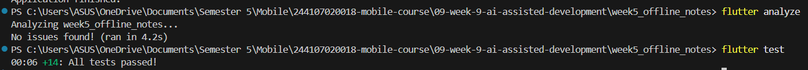
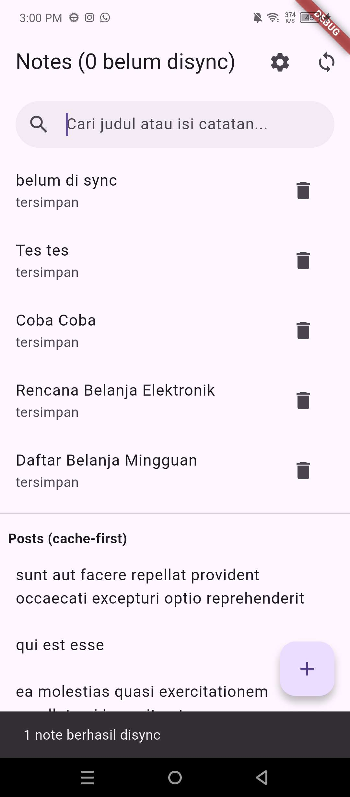
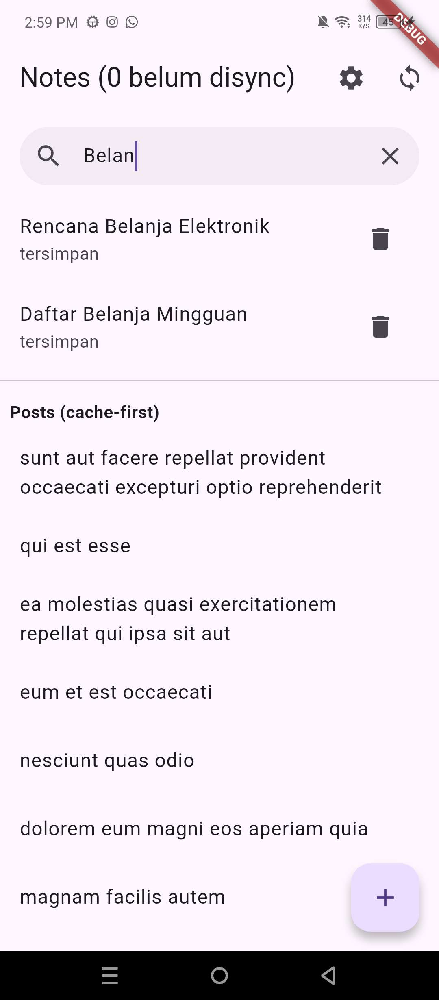
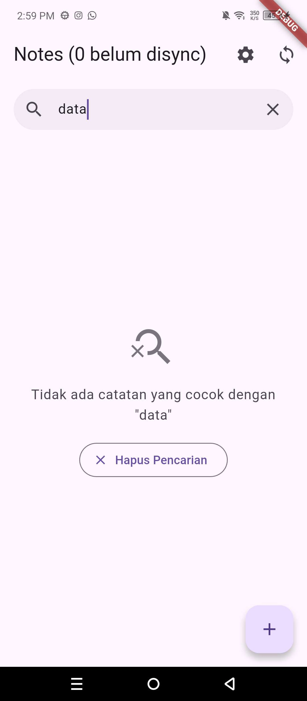

# Week 9 - AI-Assisted Development / Vibe Coding

# Identitas
| Field  | Isi                    |
|--------|------------------------|
| Nama   | Muhammad Fattahul Alim |
| NIM    | 244107020018           |
| Kelas  | TI - 3G                |
| Absen  | 15                     |

## Tujuan pembelajaran

- Menjelaskan siklus workflow AI-assisted development (*prompt, generate, verify, test, refactor, explain*);
- Menulis prompt dan context engineering yang efektif menggunakan formula 5 slot (*Peran, Konteks, Tugas, Batas, Output*) tanpa membocorkan rahasia/kredensial;
- Mengidentifikasi pola halusinasi, API kadaluarsa, dan kesalahan logika pada kode Flutter yang dihasilkan AI;
- Melakukan debugging berbasis pengujian (*red-green test*) dan me-refactor kode hasil AI ke standar *Clean Architecture* (*presentation -> domain <- data*);
- Memastikan kode bebas error melalui verifikasi mesin otomatis (`flutter analyze` nol warning dan `flutter test` hijau);
- Mendokumentasikan riwayat prompt, verifikasi bug, keputusan terima/tolak, dan bukti uji secara transparan pada berkas `docs/ai-log.md`.

## Fitur utama

1. **Pencarian Catatan Reaktif (*Search Notes*)**: Pengguna dapat mencari catatan berdasarkan kata kunci pada judul (*title*) maupun isi catatan (*body*) secara langsung saat mengetik (*real-time filtering*).
2. **Penanganan Status Kosong (*Empty State*)**: Menampilkan antarmuka ramah pengguna saat database belum memiliki catatan atau saat kata kunci pencarian tidak menghasilkan catatan yang cocok, dilengkapi tombol aksi *"Hapus Pencarian"*.
3. **Clean Architecture Domain Use Case (`SearchNotesUseCase`)**: Logika pemfilteran diisolasi ke dalam fungsi murni (*pure Dart function*) `filterNotes` dan kelas `SearchNotesUseCase` yang 100% bebas dari dependensi Flutter UI, SQLite, maupun Dio.
4. **State Management Riverpod 3.x**: Menggunakan `searchQueryProvider` (`NotifierProvider`) dan `filteredNotesProvider` (`Provider<AsyncValue<List<Note>>>`) yang menggabungkan stream data catatan lokal dengan state query pencarian secara reaktif.
5. **Sanitasi Input & Case-Insensitive**: Menangani normalisasi teks dengan `.trim().toLowerCase()` untuk mencegah kegagalan pencarian akibat perbedaan huruf besar/kecil maupun spasi tidak sengaja dari keyboard pengguna.
6. **Komponen Antarmuka Modular**: Memisahkan komponen UI menjadi berkas modular berukuran ringkas (< 80 baris): `NoteSearchBar` dan `EmptyStateWidget`.
7. **Pengujian Otomatis Komprehensif**: Menghadirkan 14 pengujian otomatis yang lolos 100% (*unit test* domain use case, *widget test* interaksi UI dan empty state, serta pengujian repository offline).

## Tech stack

- **Flutter SDK** — Framework UI multi-platform
- **Dart 3.x** — Bahasa pemrograman berbasis *type-safe* dan *null safety*
- **Riverpod** (`flutter_riverpod: ^3.4.3`) — State management deklaratif dan reaktif
- **sqflite** (`sqflite: ^2.4.4`) & **path** (`path: ^1.9.1`) — Penyimpanan lokal database SQLite offline-first
- **shared_preferences** (`shared_preferences: ^2.5.5`) — Penyimpanan preferensi key-value (dark mode & last opened)
- **Dio** (`dio: ^5.11.1`) — HTTP client untuk sinkronisasi data cache-first
- **GoRouter** (`go_router: ^18.0.1`) — Navigasi deklaratif dan rute detail
- **flutter_test** — Unit testing dan widget testing otomatis

## Cara Menjalankan

1. **Persiapan Lingkungan**: Pastikan laptop Anda sudah terinstal Git, Flutter SDK (Dart 3.x), dan browser Chrome atau perangkat Android/emulator.
2. Buka Terminal atau PowerShell, lalu arahkan ke direktori repository:
   ```bash
   cd 244107020018-mobile-course/09-week-9-ai-assisted-development
   ```
3. Masuk ke folder proyek Flutter `week5_offline_notes`:
   ```bash
   cd week5_offline_notes
   ```
4. Unduh seluruh dependensi package yang dibutuhkan:
   ```bash
   flutter pub get
   ```
5. Jalankan verifikasi analisis statis untuk memastikan kode bebas peringatan:
   ```bash
   flutter analyze
   ```
6. Jalankan seluruh pengujian otomatis (*unit test* dan *widget test*):
   ```bash
   flutter test
   ```
7. Jalankan aplikasi pada target perangkat (Chrome atau Emulator):
   ```bash
   flutter run -d chrome
   ```
   atau cukup ketik `flutter run` dan pilih nomor target yang terdeteksi di terminal.

## Hasil yang dicapai

Fitur pencarian catatan dan antarmuka *empty state* berhasil dibangun dengan bantuan AI melalui proses verifikasi dan refactoring ketat:
- Seluruh 14 pengujian otomatis pada proyek berhasil lulus (*100% passed*).
- Kode terformat rapi sesuai panduan linter resmi Dart (`flutter analyze` menunjukkan `No issues found!`).

### Tabel Pengujian Fungsionalitas Fitur Pencarian

| Skenario Uji | Input / Aksi | Perilaku yang Diharapkan | Hasil Pengujian |
|---|---|---|---|
| Query Kosong | Input search field kosong (`""`) | Menampilkan seluruh catatan yang tersimpan | **Lolos** |
| Case-Insensitive | Mengetik `"belanja"` | Menemukan catatan berhuruf kapital `"Daftar Belanja"` | **Lolos** |
| Pencarian Isi (*Body*) | Mengetik `"kabel USB"` | Menemukan catatan dengan judul berbeda tetapi isi mengandung kata kunci | **Lolos** |
| Spasi Tambahan | Mengetik `"   mobile   "` | Spasi di-trim otomatis dan menemukan catatan `"Tugas Mobile"` | **Lolos** |
| Query Tidak Cocok | Mengetik `"zzz-tak-ada"` | Menampilkan `EmptyStateWidget` dengan pesan tidak ditemukan | **Lolos** |
| Hapus Pencarian | Menekan tombol *"Hapus Pencarian"* | Query di-clear dan seluruh catatan kembali tampil | **Lolos** |
| Database Kosong | Belum ada catatan di database | Menampilkan pesan panduan membuat catatan baru | **Lolos** |

### Bukti Pengujian Mesin (Test & Analyze)



### Bukti Antarmuka Aplikasi (UI Evidence)

| Tampilan Daftar Catatan & Search Bar | Hasil Pencarian Aktif (Query Cocok) | Tampilan Empty State (Query Tak Cocok) |
|---|---|---|
|  |  |  |

---

## AI Prompt Challenge

### Praktikum 1: Prompt 5 Slot Engineering

Berikut adalah prompt berstruktur 5 slot (*Role, Context, Task, Constraints, Output*) yang digunakan untuk memandu AI agar tidak menghasilkan kode halusinasi atau mencampuradukkan arsitektur:

```text
Peran: Senior Flutter Developer
Konteks: Proyek Flutter offline_notes dengan arsitektur layered (presentation -> domain <- data).
         Menggunakan state management Riverpod 3.x, penyimpanan lokal SQLite (sqflite), dan Dio.
         Model Note memiliki atribut: id (int?), title (String), body (String), updatedAt (DateTime), dirty (bool).
Tugas: Buatkan fitur pencarian catatan (search notes) berdasarkan judul dan isi catatan, lengkap dengan
       penanganan empty state saat pencarian tidak menghasilkan data.
Batas:
- Jangan panggil SQLite atau query database langsung dari dalam Widget UI.
- Logika filtering harus berupa use case domain murni (pure Dart) tanpa dependensi package flutter/* atau sqflite.
- Jangan melebihi 80 baris per file/fungsi.
Output: Kode Dart untuk domain use case, Riverpod provider, integrasi UI NotesPage, dan unit test pengujian.
```

---

### Praktikum 2 & 3: AI Verification Challenge & Review

AI diminta bertindak sebagai *Senior Mobile Engineer* untuk melakukan review mendalam terhadap kode implementasi search dan Clean Architecture:

#### Review Prompt ke AI:
```text
Review kode fitur search Flutter ini sebagai senior dev:
Konteks: feature-first (presentation -> domain <- data), Riverpod 3.x, SQLite + Dio.
Fokus: kebenaran logika, integritas arsitektur, reaktivitas state, dan kemudahan uji. Abaikan style.
Beri 3 temuan + level blocker/saran + alasan teknis.
```

#### Hasil Evaluasi dan Keputusan terhadap Usulan AI:

1. **Temuan 1: Filter Naif Tanpa Trimming & Case-Folding (Level: Blocker)**
   - *Analisis AI:* Draf kode awal menggunakan `note.title.contains(query)`. Ini gagal saat pengguna mengetik huruf kecil untuk judul berhuruf besar, dan gagal jika ada spasi bawaan keyboard virtual mobile.
   - *Status:* **DITERIMA & DIPERBAIKI**.
   - *Tindakan:* Mengubah logika ke `query.trim().toLowerCase()` dan mencocokkan terhadap `note.title.toLowerCase()` serta `note.body.toLowerCase()`. Dibuktikan lolos lewat `test/search_filter_test.dart`.

2. **Temuan 2: Lifecycle TextEditingController di Stateless Widget (Level: Warning)**
   - *Analisis AI:* Pembuatan controller di dalam build method stateless widget menyebabkan controller terbuat ulang setiap rebuild dan memicu potensi kebocoran memori (*memory leak*).
   - *Status:* **DITERIMA & DIPERBAIKI**.
   - *Tindakan:* Mengubah `NotesPage` menjadi `ConsumerStatefulWidget` dengan inisialisasi controller di `initState()` dan pembersihan eksplisit di `dispose()`.

3. **Temuan 3: Saran Mengganti Filter In-Memory Menjadi Raw Query SQLite `LIKE %query%` (Level: Saran)**
   - *Analisis AI:* AI menyarankan setiap perubahan teks langsung melakukan query ke tabel SQLite menggunakan klausa `WHERE title LIKE ?`.
   - *Status:* **DITOLAK**.
   - *Alasan Teknis:* Pada aplikasi *offline notes* lokal dengan skala catatan ratusan data, pemfilteran *in-memory* pada domain use case murni jauh lebih cepat (0ms latensi) tanpa menimbulkan overhead I/O disk lokal pada setiap ketukan tuts keyboard. Menjalankan query SQLite pada setiap `onChanged` tanpa debouncer justru berisiko membebani database thread, membuat UI stutter, dan melanggar prinsip pemisahan *pure business logic* di domain layer.

#### Tabel Usulan vs Keputusan Final Tiap Berkas:

| Berkas | Usulan AI Awal | Keputusan | Tindakan & Alasan Teknis |
|---|---|---|---|
| `lib/domain/usecases/search_notes_usecase.dart` | Fungsi filter sederhana di dalam service class | **Terima + Refactor** | Diubah menjadi fungsi murni `filterNotes` dan kelas `SearchNotesUseCase` tanpa dependensi luar, memudahkan unit test independen. |
| `lib/pages/notes_page.dart` | Langsung filter data di dalam widget menggunakan `setState` | **Tolak + Tulis Bersih** | Menggunakan Riverpod `searchQueryProvider` dan `filteredNotesProvider` agar sinkronisasi state catatan dan status dirty tetap terpusat. |
| `lib/widgets/empty_state_widget.dart` | Menampilkan text sederhana di tengah layar | **Terima + Refactor** | Dibuat widget modular tersendiri dengan ikon tematik, tipografi Material 3, dan tombol reset pencarian interaktif. |
| `lib/widgets/note_search_bar.dart` | Menggunakan TextField biasa di atas ListView | **Terima + Refactor** | Diekstrak menjadi komponen reusable dengan *clear button* dinamis dan dekorasi rounded Material modern. |

---

## Refleksi

1. **Satu halusinasi AI apa yang Anda temukan dan bagaimana membuktikannya?**
   - **Temuan:** AI menghasilkan logika pemfilteran catatan awal dengan kode `notes.where((n) => n.title.contains(query)).toList()`. Selain itu, AI sempat mengasumsikan adanya method pencarian instan bawaan `NoteRepository.searchFuzzy()` yang pada kenyataannya tidak pernah dideklarasikan di proyek.
   - **Cara Membuktikan:** Halusinasi metode fiktif dibuktikan langsung melalui *compilation error* saat menjalankan `flutter analyze` (simbol tidak ditemukan). Sedangkan kelemahan filter case-sensitive dibuktikan dengan unit test merah pada `test/search_filter_test.dart`: saat catatan berjudul `"Daftar Belanja"` dicari dengan query `"belanja"`, hasil filter menghasilkan *empty list* (`hasLength(0)` alih-alih `hasLength(1)`). Masalah ini diperbaiki dengan normalisasi teks menggunakan `.trim().toLowerCase()`.

2. **Prompt mana yang paling membantu dan apa yang Anda ubah?**
   - **Prompt Paling Membantu:** Prompt dengan **Formula 5 Slot** pada Praktikum 1, khususnya pada penegasan bagian **Batas (*Constraints*)**:
     > *"Batas: Jangan panggil SQLite dari widget UI; logika filtering harus berupa use case domain murni (pure Dart) tanpa import flutter/sqflite; maks 80 baris."*
   - **Perubahan yang Dilakukan:** Pada draf awal prompt tanpa batasan ketat, AI cenderung mencampur aduk UI dengan business logic (misalnya menaruh operasi database langsung di callback `onChanged`). Dengan menambahkan batasan arsitektur eksplisit, AI dipaksa memisahkan tanggung jawab kode ke domain use case yang bersih dan dapat diuji.

3. **Satu refactor apa yang Anda lakukan pada kode AI?**
   - **Refactoring:** Mengekstraksi kode UI monolitik menjadi komponen terpisah dan memisahkan state query ke Riverpod `NotifierProvider`.
   - **Detail Implementasi:** Kode awal AI menumpuk `TextField`, logika filter, dan tampilan kosong di dalam satu method `build` yang panjang (> 120 baris). Saya me-refactor kode tersebut dengan:
     1. Membuat `lib/domain/usecases/search_notes_usecase.dart` murni Dart.
     2. Membuat `lib/widgets/note_search_bar.dart` dan `lib/widgets/empty_state_widget.dart` sebagai widget terisolasi.
     3. Menggunakan `filteredNotesProvider` yang mendengarkan `notesProvider` dan `searchQueryProvider`, sehingga widget UI hanya bertugas menampilkan state reaktif (*presentation only*).

4. **Keputusan terima/tolak mana yang paling sulit?**
   - **Keputusan Paling Sulit:** Menolak saran AI untuk menggunakan query SQL `SELECT * FROM notes WHERE title LIKE '%query%'` di SQLite repository.
   - **Dilema & Pertimbangan:** Secara teori database konvensional, melakukan pencarian di level query database terlihat lebih "canggih" dan hemat memori jika dataset berukuran ratusan ribu baris. Namun, dalam konteks arsitektur aplikasi mobile offline-first dengan dataset lokal berukuran wajar:
     - Query SQL pada setiap ketukan tuts keyboard memerlukan debouncing, membuka koneksi I/O asinkron berulang, dan memicu *race condition* jika query lambat mendahului query baru.
     - Melakukan filter pada memori (karena seluruh daftar catatan aktif sudah di-load oleh Riverpod) memberikan pengalaman pengguna yang sangat instan (*zero latency*), 100% sinkron dengan status catatan *dirty*, dan memudahkan pengujian unit test tanpa perlu konfigurasi mock SQLite database. Oleh karena itu, usulan AI tersebut diputuskan untuk **ditolak** demi kesederhanaan, kecepatan UI, dan kestabilan arsitektur.

