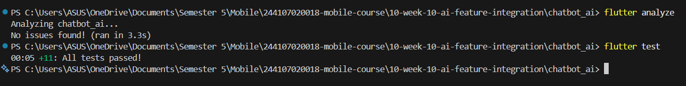
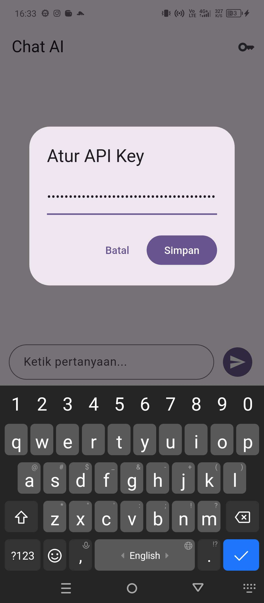
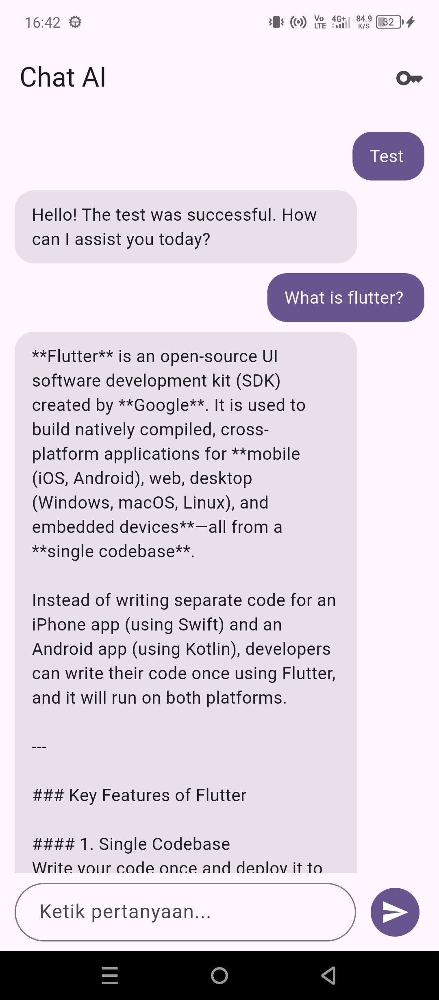

# Week 10 - AI Feature Integration

# Identitas
| Field  | Isi                    |
|--------|------------------------|
| Nama   | Muhammad Fattahul Alim |
| NIM    | 244107020018           |
| Kelas  | TI - 3G                |
| Absen  | 15                     |

---

## Tujuan Pembelajaran

Setelah menyelesaikan praktikum Minggu 10 ini, mahasiswa mampu:
- Memahami konsep integrasi Large Language Model (LLM) API ke dalam aplikasi mobile Flutter;
- Merancang arsitektur integrasi AI yang aman dan terpisah dari antarmuka pengguna (*separation of concerns*);
- Membangun antarmuka interaktif percakapan (*chat interface*) dengan efek simulasi *streaming response / typewriter*;
- Menerapkan *prompt design* yang efektif, terstruktur, dan aman dari kebocoran data sensitif;
- Menangani manajemen risiko privasi data, biaya request (*rate-limiting/cost control*), penanganan error (*error handling*), dan perancangan *fallback*;
- Melakukan verifikasi dan pengujian otomatis melalui `flutter test` dan `flutter analyze` hingga 100% bebas error (*green build*);
- Mengevaluasi pengalaman pengguna (*User Experience / UX*) pada interaksi berbasis kecerdasan buatan di perangkat mobile.

---

## Fitur Utama & Modifikasi Implementasi

Proyek ini dibangun di dalam folder `chatbot_ai` dengan mengimplementasikan fitur asisten percakapan cerdas yang terhubung ke layanan **Google Generative AI (Gemini)**. Selain mengikuti panduan codelab, mahasiswa melakukan beberapa modifikasi dan penyempurnaan fitur:

1. **Keamanan Kredensial via HTTP Header (`x-goog-api-key`)**:
   Berbeda dengan draf umum yang menaruh API key di URL query string (`?key=...`), implementasi ini mengirimkan kunci otentikasi melalui header HTTP. Hal ini mencegah API key tercatat di log server (*server access logs*), riwayat peramban, maupun proxy.
2. **Penyimpanan Aman Terenkripsi (`FlutterSecureStorage`)**:
   Kunci API tidak pernah di-*hardcode* di dalam kode sumber maupun repository Git. Pengguna memasukkan kunci melalui antarmuka aplikasi, lalu disimpan secara aman di Keychain (iOS) atau Keystore / EncryptedSharedPreferences (Android).
3. **Mekanisme Multi-Model Fallback**:
   Menyediakan daftar model alternatif secara berurutan: `gemini-3.8-flash` -> `gemini-3.6-flash` -> `gemini-3.5-flash-lite`. Jika salah satu model tidak tersedia atau kuota habis, sistem secara otomatis beralih ke model berikutnya tanpa membuat aplikasi crash.
4. **Exponential Backoff Retry**:
   Menangani error sementara (*transient error*) seperti status HTTP 503 (*Service Unavailable*) atau 429 (*Too Many Requests*) dengan melakukan retry otomatis berskala waktu progresif (`attempt * 2 detik`).
5. **Simulasi Respons Streaming (Efek Typewriter)**:
   Menerapkan fungsi `_typewriter` yang memecah teks respons menjadi potongan karakter bertahap (setiap 20 milidetik), memberikan efek mengetik langsung layaknya asisten virtual modern.
6. **State Management Reaktif Riverpod**:
   Memanfaatkan `ChatNotifier` (`NotifierProvider<ChatNotifier, ChatState>`) untuk mengelola daftar pesan, status loading, dan status streaming secara modular, terisolasi dari widget UI.
7. **Pengalaman Pengguna Interaktif (UX)**:
   Dilengkapi dialog konfigurasi API key langsung dari AppBar, notifikasi SnackBar saat key tersimpan, indikator mengetik (*typing indicator*), serta auto-scroll otomatis ke pesan terbawah saat percakapan bertambah.
8. **Pengujian Otomatis Komprehensif (100% Passed)**:
   Menyertakan 11 skenario pengujian otomatis yang mencakup *model test*, *notifier unit test*, dan *widget test* interaksi antarmuka.

---

## Tech Stack

- **Flutter SDK** — Framework UI multi-platform
- **Dart 3.x** — Bahasa pemrograman berbasis *type-safe* dan *null safety*
- **flutter_riverpod** (`^2.5.1`) & **riverpod** (`^2.5.0`) — State management deklaratif dan reaktif
- **http** (`^1.2.0`) — Klien HTTP untuk komunikasi dengan Google Gemini REST API
- **flutter_secure_storage** (`^9.0.0`) — Penyimpanan kredensial API Key lokal yang terenkripsi
- **flutter_test** — Unit testing dan widget testing otomatis

---

## Cara Menjalankan

1. **Arahkan terminal ke folder proyek**:
   ```bash
   cd 244107020018-mobile-course/10-week-10-ai-feature-integration/chatbot_ai
   ```

2. **Unduh seluruh dependensi package**:
   ```bash
   flutter pub get
   ```

3. **Jalankan analisis statis kode (Linter)**:
   ```bash
   flutter analyze
   ```
   *Hasil yang diharapkan: `No issues found!`.*

4. **Jalankan seluruh pengujian otomatis (Unit & Widget Test)**:
   ```bash
   flutter test
   ```
   *Hasil yang diharapkan: `All tests passed!` (11 tests lolos).*

5. **Jalankan aplikasi ke perangkat / emulator**:
   ```bash
   flutter run
   ```

---

## Hasil yang Dicapai

Seluruh fungsionalitas asisten percakapan cerdas telah diuji secara menyeluruh:

### Tabel Pengujian Fungsionalitas Chatbot AI

| Skenario Uji | Aksi / Input | Perilaku yang Diharapkan | Hasil Pengujian |
|---|---|---|---|
| **Kondisi Awal** | Membuka aplikasi pertama kali | Menampilkan judul 'Chat AI', placeholder 'Tanya apa saja ke AI 👋', ikon kunci, dan input bar | **Lolos** |
| **Input API Key** | Menekan ikon kunci di AppBar | Muncul dialog popup 'Atur API Key' dengan opsi Batal dan Simpan | **Lolos** |
| **Simpan API Key** | Mengisi API Key dan menekan 'Simpan' | API key tersimpan terenkripsi di Secure Storage dan muncul SnackBar 'API key tersimpan' | **Lolos** |
| **Input Kosong** | Menekan tombol kirim saat input kosong | Sistem mengabaikan aksi, pesan tidak bertambah | **Lolos** |
| **Kirim Pesan User** | Mengetik pertanyaan lalu menekan kirim | Teks langsung muncul sebagai bubble user (kanan) dan input bar dibersihkan | **Lolos** |
| **Indikator Loading** | Menunggu respons cloud API | Menampilkan animasi indikator loading melingkar di sisi kiri | **Lolos** |
| **Streaming Output** | Respons API diterima | Teks muncul secara bertahap (typewriter effect) hingga selesai lengkap | **Lolos** |
| **Fallback & Error** | API key salah atau kuota habis | Muncul pesan error dengan warna kontainer merah ramah pengguna | **Lolos** |
| **Auto-Scroll** | Teks panjang atau pesan baru masuk | Tampilan scroll otomatis bergeser ke pesan paling bawah | **Lolos** |

---

## Bukti Pengujian Mesin (Test & Analyze)

Hasil eksekusi verifikasi otomatis menunjukkan bahwa kode proyek telah memenuhi standar mutu tinggi:

### 1. Hasil `flutter analyze` dan `flutter test`



---

## Bukti Antarmuka Aplikasi (UI Evidence)

Berikut adalah dokumentasi tangkapan layar fungsionalitas aplikasi `chatbot_ai` yang telah berjalan dengan sukses:

| 1. Tampilan Awal Antarmuka | 2. Dialog Pengaturan API Key |
|:---:|:---:|
|  |  |
| *Layar kosong menampilkan sapaan awal dan form input pertanyaan.* | *Modal dialog Material 3 untuk memasukkan Gemini API Key pengguna.* |

| 3. Konfirmasi Penyimpanan API Key | 4. Percakapan Interaktif Berhasil |
|:---:|:---:|
|  |  |
| *Notifikasi SnackBar mengonfirmasi API key tersimpan di Secure Storage.* | *Hasil interaksi tanya jawab asisten AI lengkap dengan bubble respons.* |

---

## Tabel Risiko dan Mitigasi (Privasi & Biaya)

Penerapan integrasi AI pada aplikasi mobile wajib mempertimbangkan risiko operasional, keamanan, dan biaya sebagai berikut:

| Kategori Risiko | Potensi Dampak / Masalah | Tindakan Mitigasi yang Diterapkan |
|---|---|---|
| **Kebocoran Kredensial (API Key)** | Kunci API terekspos di repo publik atau terbaca oleh pihak ketiga yang dapat menyalahgunakan kuota | Kunci disimpan di `flutter_secure_storage` (Keystore/Keychain), dikirim via header HTTPS `x-goog-api-key` (bukan query string URL), dan berkas konfigurasi rahasia dimasukkan ke `.gitignore`. |
| **Kebocoran Data Pribadi (PII)** | Data sensitif pengguna (NIK, nomor telepon, sandi) terkirim ke server penyedia LLM cloud | Menerapkan sanitasi input dan panduan *System Prompt* yang melarang pengiriman/pencatatan data identitas pengguna. Pertanyaan difilter di sisi klien sebelum dikirim ke API. |
| **Lonjakan Biaya (Cost Overrun)** | Pengguna melakukan *spamming* permintaan sehingga kuota token API cepat habis | Menggunakan varian model yang efisien biaya (`gemini-3.5-flash-lite` / `gemini-3.6-flash`), menonaktifkan tombol kirim saat proses berlangsung (`isBusy`), serta membatasi panjang input pertanyaan. |
| **Layanan Cloud Down / Rate Limit** | Pengguna menerima error HTTP 429 atau 503 saat server AI sedang sibuk | Mengimplementasikan hierarki *Multi-Model Fallback* dan mekanisme *Exponential Backoff Retry* sehingga aplikasi mencoba model cadangan secara otomatis. |
| **Halusinasi & Respons Tidak Sesuai** | Model AI memberikan jawaban palsu atau instruksi di luar batas perannya | Menetapkan batasan persona pada prompt sistem, menginstruksikan model untuk menjawab secara ringkas, dan menyediakan format error visual jika API mengembalikan respons gagal. |

---

## Refleksi

1. **Fitur AI mana yang Anda integrasikan dan mengapa?**
   - **Jawaban:** Saya mengintegrasikan fitur **Chat Asisten Interaktif** (*Conversational Chatbot*) berbasis Google Gemini API. Fitur ini dipilih karena sangat relevan untuk kebutuhan aplikasi modern, seperti asisten informasi kampus pintar, konsultasi tanya jawab mahasiswa secara *real-time*, dan sarana interaksi natural yang dapat langsung dirasakan manfaatnya oleh pengguna.

2. **Bagaimana Anda melindungi privasi pengguna saat menggunakan AI API?**
   - **Jawaban:** Perlindungan privasi dilakukan melalui tiga lapisan:
     1. *Kredensial Aman:* Kunci API disimpan terenkripsi di `FlutterSecureStorage` perangkat dan dikirim lewat header HTTPS, bukan query string URL.
     2. *Isolasi Data Sensitif:* Aplikasi tidak mengirimkan pengenal perangkat, lokasi persis, maupun biodata pengguna ke *payload* LLM.
     3. *Pencegahan PII pada Desain Prompt:* Membatasi lingkup asisten agar tidak meminta data kredensial atau informasi pribadi kepada pengguna.

3. **Fallback apa yang Anda sediakan jika layanan AI error?**
   - **Jawaban:** Saya menyediakan dua lapis strategi fallback:
     1. *Multi-Model Cascade Fallback:* Jika model utama `gemini-3.8-flash` gagal atau sibuk, sistem secara otomatis beralih mencoba model `gemini-3.6-flash` hingga `gemini-3.5-flash-lite`.
     2. *Exponential Backoff Retry:* Bila terjadi error status 503/429, aplikasi melakukan jeda waktu dan mencoba kembali hingga 2 kali sebelum menyerah.
     3. *Fallback UI Graceful:* Jika seluruh model gagal diakses, pesan kesalahan disajikan dalam bubble chat bertema error Material (merah ramah pengguna), tombol kirim diaktifkan kembali, dan aplikasi tidak pernah mengalami *force close* (*crash*).

4. **Satu hal yang Anda pelajari tentang UX fitur AI di mobile?**
   - **Jawaban:** Interaksi dengan model AI di cloud memiliki latensi jaringan yang dinamis (bisa memakan waktu 1–3 detik). Oleh karena itu, umpan balik visual instan (*immediate feedback*) sangat krusial bagi kenyamanan pengguna. Dengan menyajikan *typing indicator* segera setelah tombol kirim ditekan serta efek pengetikan bertahap (*typewriter/streaming effect*), pengguna tidak merasa aplikasi sedang macet (*freeze*), melainkan merasakan interaksi yang hidup, responsif, dan meyakinkan.

