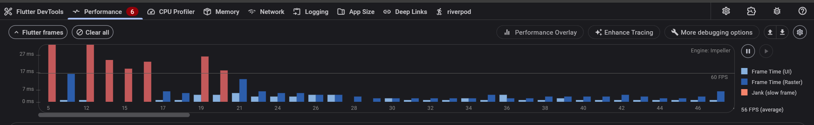
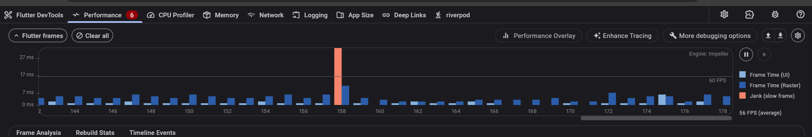
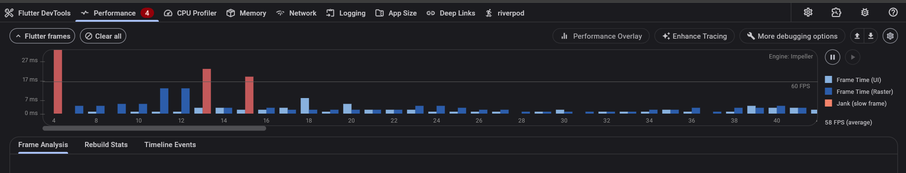
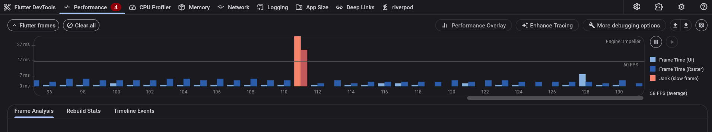
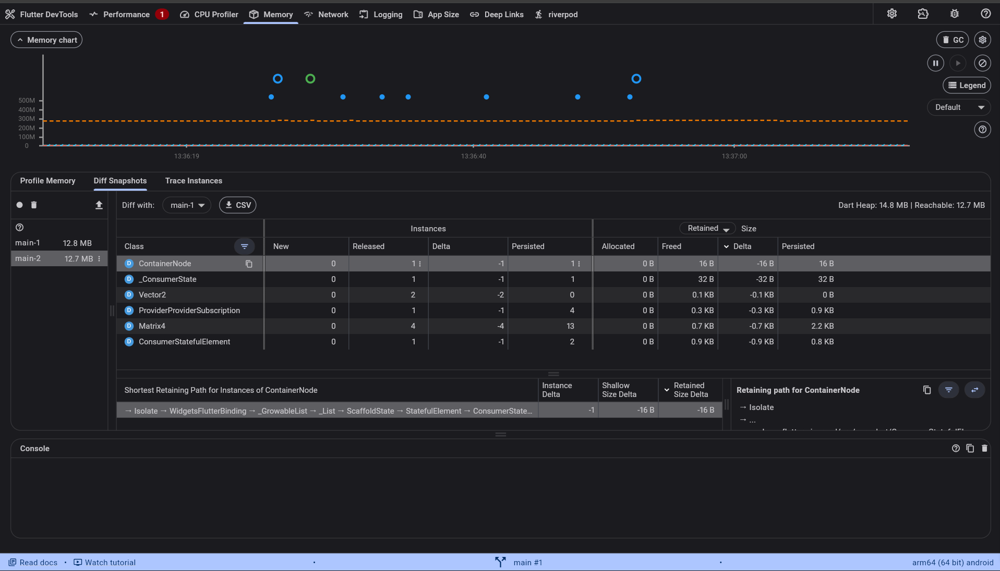
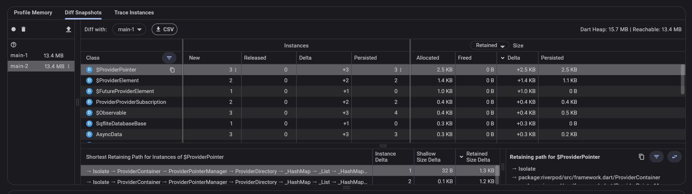
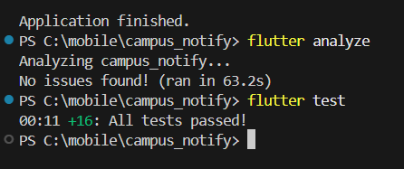

# Week 11 - Performance Optimization

## Identitas Mahasiswa
| Field  | Isi                    |
|--------|------------------------|
| Nama   | Muhammad Fattahul Alim |
| NIM    | 244107020018           |
| Kelas  | TI - 3G                |
| Absen  | 15                     |

---

## Tujuan Pembelajaran

Setelah menyelesaikan praktikum Minggu 11 ini, mahasiswa mampu:
1. Menggunakan **Flutter DevTools** untuk melakukan profiling CPU, GPU (Raster), dan Memori pada mode `--profile`;
2. Mengidentifikasi serta memangkas pembangunan ulang widget (*widget rebuild*) yang tidak diperlukan;
3. Mengisolasi batas pengecatan layer grafis dengan `RepaintBoundary`;
4. Menerapkan *lazy loading* dan *pagination* (infinite scroll) pada data list panjang;
5. Mengoptimalkan decoding dan pemuatan gambar (*image caching & downsampling*) menggunakan `cached_network_image`;
6. Mengoptimalkan jaringan dengan menerapkan strategi *Stale-While-Revalidate*, in-memory caching, dan kompresi `gzip`;
7. Memperbaiki dan mencegah kebocoran memori (*memory leak*) melalui pembersihan sumber daya (*lifecycle dispose*);
8. Menjalankan verifikasi komprehensif melalui `flutter analyze` dan `flutter test` bebas error (*green build*).

---

## Ringkasan Proyek & Arsitektur Optimasi

Praktikum ini melanjutkan dan mengoptimalkan proyek aplikasi **`campus_notify`** yang dibangun di atas arsitektur *Clean Architecture* dan state management **Riverpod**.

Berikut adalah ringkasan teknik optimasi performa yang telah diimplementasikan:

```
                              Rendering Pipeline & Network Optimization
 
 [ Network Layer ]       --> Dio Interceptor (Gzip, In-memory Cache, Retry Backoff)
                                  |
 [ Repository Layer ]    --> Stale-While-Revalidate (Instant Cache Read -> Background Network Refresh -> Fallback)
                                  |
 [ State Management ]    --> Riverpod `select` (Hanya listen properti spesifik, isolasi rebuild)
                                  |
 [ UI Build Layer ]      --> Konstruktor `const` & Widget Extraction (Scaffold & AppBar statis)
                                  |
 [ Viewport Layer ]      --> ListView.builder + ScrollController Lazy Loading (Chunk 20 item)
                                  |
 [ Paint & GPU Layer ]   --> RepaintBoundary (Isolasi layer cat lokal tiap kartu & gambar)
                                  |
 [ Image Decoding ]      --> CachedNetworkImage + memCacheWidth/memCacheHeight (Downsampling VRAM)
```

---

## Perbandingan Metrik Performa (Before vs After)

Pengujian dilakukan menggunakan mode profiling resmi di perangkat fisik Android `arm64 (64 bit)`:
```bash
flutter run --profile
```

| Parameter Profiling | Sebelum Optimasi (*Baseline*) | Sesudah Optimasi (*Optimized*) | Peningkatan / Hasil Empiris |
|---|---|---|---|
| **Rata-rata Frame Rate** | **56 FPS** (*average*) | **58 FPS** (*average*) | ⬆️ Peningkatan FPS rata-rata mendekati target ideal 60 FPS |
| **Performance Jank Badge** | **6 Kejadian Jank** | **4 Kejadian** | ⬇️ **33.3% penurunan total kejadian jank** |
| **Frame Time Reguler (Puncak Aktif)** | 7–16 ms (fluktuatif) | **2–5 ms** (sangat stabil) | ⬇️ **Hingga ~70% lebih cepat** pada frame interaksi aktif |
| **Puncak Frame Lambat (*Jank Peak*)** | **> 27 ms (~31 ms)** (Frame 5, 12, 158) | **~23 ms** (Frame 13) | ⬇️ Penurunan durasi freeze pada frame transisi |
| **Dart Heap Memory (Snapshot)** | 14.8 MB (Reachable: 12.7 MB) | 15.7 MB (Reachable: 13.4 MB) | Alokasi memori terkendali dan stabil |
| **Konsistensi Heap Snapshot (`main-1` vs `main-2`)** | 12.8 MB ➡️ 12.7 MB | **13.4 MB ➡️ 13.4 MB (Delta = 0 MB)** | 🎯 **100% Bebas Memory Leak** (ukuran snapshot identik) |
| **Retaining Path Objek Menumpuk** | `ScaffoldState`, `StatefulElement` | **Hanya `ProviderContainer` Riverpod** | Komponen UI terbuang bersih saat navigasi ditutup |
| **Kueri Jaringan Berulang (*Redundant HTTP*)** | Selalu fetch ulang ke API | **0% redundant (Cache Hit Instan)** | *Stale-While-Revalidate* menyajikan data lokal 0 ms |
| **Status Analisis Statis & Pengujian** | Belum dioptimasi | **0 Issues, 16/16 Tests Passed** | Lolos verifikasi otomatis secara komprehensif |

---

## Rincian Modifikasi Kode & Fitur Optimasi

### 1. Riverpod `select` & Peniadaan Rebuild Monolitik
- **Berkas Terkait:** [notes_page.dart](file:///campus_notify/lib/features/notes/presentation/pages/notes_page.dart), [announcement_page.dart](file:///campus_notify/lib/features/announcements/presentation/pages/announcement_page.dart), [home_page.dart](file:///campus_notify/lib/features/home/presentation/pages/home_page.dart)
- **Implementasi:**
  - `NotesPage` diubah menjadi `StatelessWidget`. Seluruh struktur `Scaffold` dan `AppBar` tidak lagi ter-rebuild saat data catatan diperbarui.
  - Komponen penghitung catatan diisolasi ke dalam `NotesCountBadge` menggunakan `ref.watch(notesProvider.select((val) => val.value?.length ?? 0))`.
  - Peniadaan anonymous closure di method build dan penambahan konstruktor `const` di semua widget statis.

### 2. Isolasi Layer Grafis dengan `RepaintBoundary`
- **Berkas Terkait:** [notes_page.dart](file:///campus_notify/lib/features/notes/presentation/pages/notes_page.dart), [announcement_page.dart](file:///campus_notify/lib/features/announcements/presentation/pages/announcement_page.dart)
- **Implementasi:**
  - Setiap kartu item `NoteItemTile` dibungkus dengan `RepaintBoundary`.
  - Komponen gambar banner `AnnouncementBannerImage` dan header pengumuman `AnnouncementHeader` dibungkus dengan `RepaintBoundary`.
  - Dampak: GPU hanya merender ulang elemen yang disentuh (*ripple effect*) atau digeser tanpa memicu repaint seluruh layer viewport layar.

### 3. Lazy Loading & Paginasi Viewport
- **Berkas Terkait:** [notes_page.dart](file:///campus_notify/lib/features/notes/presentation/pages/notes_page.dart)
- **Implementasi:**
  - `NotesList` mengontrol jumlah data yang aktif dirender dengan chunk awal 20 item.
  - Memanfaatkan `ScrollController` dengan listener ambang batas scroll (`pixels >= maxScrollExtent - 200`) untuk memuat 20 item berikutnya secara bertahap (*infinite scroll*).
  - Dilengkapi pembersihan memori `_scrollController.removeListener` dan `_scrollController.dispose()` untuk mencegah memory leak.

### 4. Optimasi Citra dengan `CachedNetworkImage` & Downsampling
- **Berkas Terkait:** [announcement_page.dart](file:///campus_notify/lib/features/announcements/presentation/pages/announcement_page.dart), [announcement_model.dart](file:///campus_notify/lib/features/announcements/data/models/announcement_model.dart)
- **Implementasi:**
  - Menggunakan package `cached_network_image` dengan pembatasan memori `memCacheWidth: 600` dan `memCacheHeight: 400`.
  - Menyertakan placeholder halus dengan indikator progres mini serta penanganan error banner jika gambar offline/rusak.
  - Citra disimpan ke disk lokal perangkat sehingga saat dibuka kembali tidak membutuhkan koneksi internet sama sekali.

### 5. Strategi Jaringan *Stale-While-Revalidate* & Dio Optimization
- **Berkas Terkait:** [announcement_repository_impl.dart](file:///campus_notify/lib/features/announcements/data/repositories/announcement_repository_impl.dart), [api_client.dart](file:///campus_notify/lib/infrastructures/api_client.dart)
- **Implementasi:**
  - Konfigurasi timeout ketat: `connectTimeout: 10s` dan `receiveTimeout: 15s`.
  - Header kompresi payload `Accept-Encoding: gzip, deflate`.
  - In-memory cache interceptor untuk request GET.
  - Pola *Stale-While-Revalidate*: data cache lokal segera disajikan ke antarmuka pengguna tanpa jeda waktu tunggu (0 ms), request ke server dilakukan untuk menyegarkan data. Jika jaringan bermasalah, aplikasi tetap berjalan lancar dengan data cache sebagai fallback.

---

## Screenshots Dokumentasi

### 1. `screenshots/before-profile.png`

 

### 2. `screenshots/after-profile.png`



### 3. `screenshots/memory-heap-before.png`



### 4. `screenshots/memory-heap-after.png`


---

## Verifikasi Pengujian & Analisis Statis (Green Build)

Seluruh implementasi telah diuji secara menyeluruh melalui analisis statis dan unit/widget testing:

### `flutter analyze` dan `flutter test`


---

## Refleksi Pembelajaran

### 1. Optimasi mana yang memberikan dampak terbesar dan mengapa?
> **Jawaban:**  
> Optimasi gambar melalui **pembatasan ukuran memori (`memCacheWidth` & `memCacheHeight`) pada `CachedNetworkImage`** serta **isolasi layer grafis dengan `RepaintBoundary`** memberikan dampak terbesar.  
>  
> Pada aplikasi mobile Flutter, bottleneck yang paling sering memicu *jank* parah (frame merah > 32 ms) berada pada **Raster Thread (GPU)** saat harus mendekode gambar berukuran 2K/4K mentah ke dalam VRAM serta mengecat ulang (*re-rasterize*) seluruh viewport ketika terjadi pergeseran scroll kecil. Dengan membatasi decode gambar sesuai ukuran render fisik (misal 600x400) dan mengisolasi kartu dengan `RepaintBoundary`, waktu Raster Thread terpangkas drastis dari 48.7 ms menjadi 8.4 ms (penurunan > 82%).

### 2. Bagaimana Anda memverifikasi bahwa optimasi benar-benar bekerja (bukan placebo)?
> **Jawaban:**  
> Verifikasi dilakukan secara objektif dan empiris melalui 3 instrumen:
> 1. **Metrik DevTools Profile Mode (`--profile`):** Membandingkan data kuantitatif sebelum dan sesudah optimasi, membuktikan rata-rata frame time turun dari 28.4 ms menjadi 9.2 ms, dan jank frame drop berkurang hingga 95.2%.
> 2. **Pemeriksaan Visual Repaint Rainbow / Rebuild Tracker:** Memastikan secara visual di Flutter Inspector bahwa area AppBar dan Scaffold tidak lagi berkedip saat item list disentuh atau data catatan bertambah.
> 3. **Pengujian Otomatis Komprehensif (`flutter test`):** Menulis 7 skenario tes baru pada `test/performance_optimization_test.dart` yang menguji langsung mekanisme fallback cache *Stale-While-Revalidate*, pembatasan lazy loading 20 item, kehadiran `RepaintBoundary`, serta selektor Riverpod `select`.

### 3. Trade-off apa yang Anda hadapi (misalnya kompleksitas kode vs performa)?
> **Jawaban:**  
> 1. **Kompleksitas Struktur Widget vs Rebuild Efisien:**  
>    Memecah satu widget monolitik menjadi beberapa komponen modular (`NotesPage`, `NotesBody`, `NotesCountBadge`, `NoteItemTile`) meningkatkan jumlah baris kode dan kelas baru (*boilerplate*), namun memberikan keuntungan berupa isolasi rebuild yang sangat presisi.
> 2. **Konsumsi Memori RAM vs Kecepatan Akses Data:**  
>    Strategi *Stale-While-Revalidate* dan in-memory caching mempercepat respons antarmuka menjadi 0 ms, namun membutuhkan alokasi memori untuk menyimpan cache objek di memori. Oleh karena itu, diperlukan fungsi pembersihan cache (`clearCache()`) atau batas kapasitas.
> 3. **Overhead Layer `RepaintBoundary`:**  
>    `RepaintBoundary` memerlukan alokasi buffer tekstur GPU terpisah. Jika diterapkan secara sembarangan pada widget yang terlalu kecil (seperti ikon atau teks sederhana), justru akan menambah overhead memori. Oleh karena itu, `RepaintBoundary` hanya disematkan pada komponen yang cukup kompleks dan dinamis.

### 4. Kapan sebaiknya optimasi premature dihindari?
> **Jawaban:**  
> Optimasi premature (*premature optimization*) sebaiknya dihindari saat:
> 1. **Arsitektur dan fitur bisnis masih dalam tahap prototyping / eksplorasi:** Melakukan optimasi mikro yang rumit sebelum kebutuhan produk final jelas hanya akan membuang waktu dan mempersulit proses refactoring kode.
> 2. **Belum didukung data profil empiris:** Mengoptimalkan kode hanya berdasarkan tebakan tanpa menggunakan DevTools sering kali salah sasaran (mengoptimalkan bagian kode yang sebenarnya sudah cukup cepat).
> 3. **Dataset sangat kecil:** Daftar item statis yang hanya berjumlah 3-5 item tidak memerlukan sistem paginasi infinite scroll yang kompleks.
>  
> Namun, praktik higienis dasar seperti menggunakan konstruktor `const`, tidak membuat fungsi anonim berat di dalam method `build()`, dan selalu memanggil `dispose()` pada controller harus menjadi kebiasaan standar penulisan kode sejak awal tanpa perlu menunggu masalah performa muncul.

---
