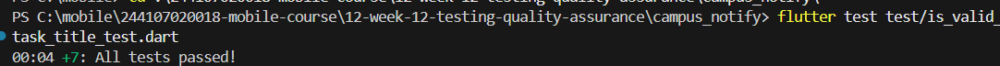
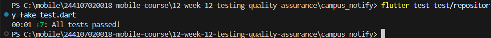
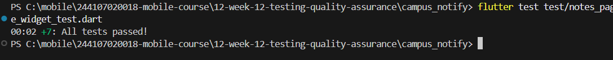
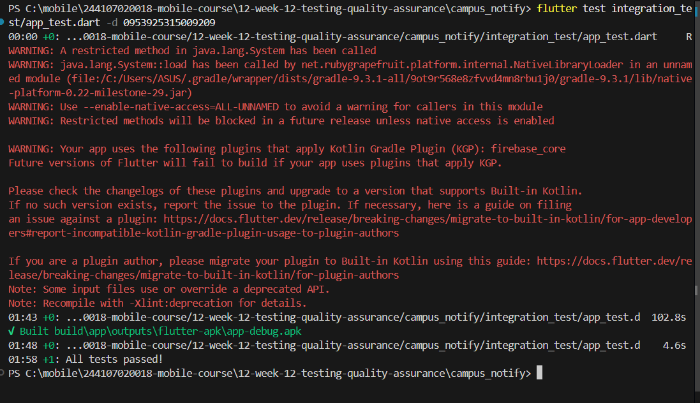
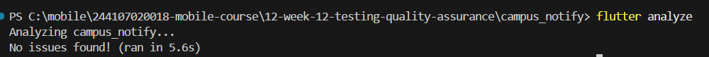
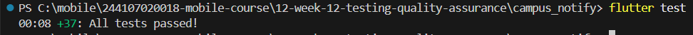
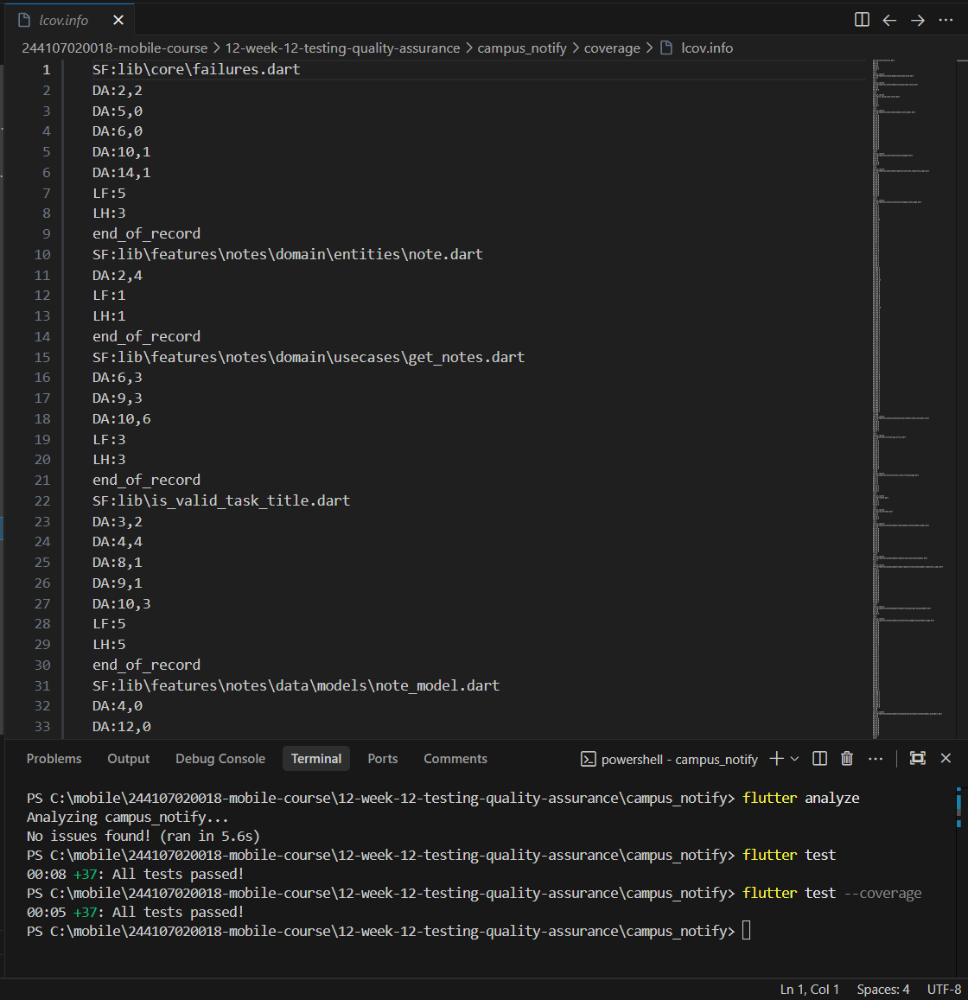

# Laporan Praktikum Minggu 12: Pengujian dan Jaminan Kualitas (Testing & Quality Assurance)

## Identitas Mahasiswa
| Field | Isi |
|---|---|
| **Nama** | Muhammad Fattahul Alim |
| **NIM** | 244107020018 |
| **Kelas** | TI - 3G |
| **Absen** | 15 |

---

## 1. Tujuan Pembelajaran

Setelah menyelesaikan praktikum Minggu 12 ini, mahasiswa mampu:
1. Menentukan dan memetakan bagian aplikasi yang tepat untuk diuji menggunakan **Unit Test**, **Widget Test**, atau **Integration Test**;
2. Menulis pengujian unit berbasis pola **Arrange, Act, Assert (AAA)** untuk memvalidasi aturan bisnis serta kasus tepi (*edge cases*);
3. Mengisolasi dependensi eksternal (basis data SQLite, REST API, jaringan) melalui abstraksi kontrak repositori (*repository interface*) dan implementasi tiruan (*fake repository*);
4. Menulis pengujian widget untuk memverifikasi tampilan antarmuka (*rendering*), *state management*, serta simulasi interaksi pengguna (*enter text*, *tap*, *pump & settle*);
5. Mengonfigurasi dan menjalankan pengujian integrasi (*end-to-end integration test*) menggunakan pustaka resmi `integration_test`;
6. Menghasilkan dan mengevaluasi laporan cakupan kode (*code coverage*) dengan perintah `flutter test --coverage` serta menjamin kebersihan kode via `flutter analyze`.

---

## 2. Ringkasan & Strategi Pengujian Aplikasi Flutter

### Piramida Pengujian Flutter
Pengujian perangkat lunak pada ekosistem Flutter dirancang dalam tiga jenis pengujian. Pertama, Unit Test, yaitu pengujian fungsi logika, entitas, usecase, dan fake repository. Kedua, Widget Test, yaitu pengujian tampilan dan interaksi UI secara headless tanpa emulator. Ketiga, Integration Test (E2E), yaitu pengujian alur aplikasi utuh pada perangkat atau emulator.

| Tingkatan Pengujian | Ruang Lingkup Pengujian | Kecepatan Eksekusi | Lingkungan Eksekusi | Biaya Pemeliharaan |
|---|---|---|---|---|
| **Unit Test** | Memvalidasi satu fungsi, method, usecase, atau class bisnis secara terisolasi tanpa merender UI. | Sangat Cepat (milidetik) | Dart VM lokal (tanpa emulator) | Rendah |
| **Widget Test** | Memvalidasi hierarki widget, tata letak, event handling, dan pembaruan state reaktif. | Cepat (1-3 detik) | Headless Flutter Test Environment | Sedang |
| **Integration Test** | Memvalidasi alur aplikasi utuh dari perspektif pengguna akhir (*end-to-end*) mencakup beberapa fitur. | Lebih Lambat (30-60+ detik) | Emulator / Simulator / Perangkat Nyata / Desktop OS Runner | Tinggi |

### Prinsip Desain Kode Mudah Diuji (*Testable Code*)
Dalam proyek **`campus_notify`**, arsitektur Clean Architecture memisahkan tanggung jawab secara tegas:
- **Presentation Layer**: Widget hanya menangani rendering dan mendengarkan event;
- **Domain Layer**: Mengatur aturan bisnis dan kontrak repositori (`abstract class NoteRepository`);
- **Data Layer**: Menangani implementasi data fisik (SQLite `sqflite`, Dio API Client).
Dengan menyuntikkan repositori melalui konstruktor dan provider (`flutter_riverpod`), unit test dan widget test dapat mengganti implementasi database asli dengan `FakeNoteRepository` tanpa memodifikasi kode produksi.

---

## 3. Langkah Praktikum & Implementasi Pengujian

### Langkah 1: Pencatatan Skenario Perilaku Fitur

Pada praktikum ini, fitur yang diuji secara komprehensif adalah fitur **Manajemen Catatan & Tugas (Notes & Tasks)** pada aplikasi `campus_notify`. Fitur ini memiliki 3 skenario utama:

1. **Skenario Kasus Utama (Happy Path):**
   - Pengguna membuka halaman Catatan.
   - Pengguna menekan tombol Floating Action Button (FAB) `Tambah Catatan`.
   - Pengguna memasukkan judul yang valid (contoh: `"Baca materi"`) dan deskripsi opsional.
   - Pengguna menekan tombol `"Simpan"`.
   - Form tertutup dan item baru berhasil dirender pada daftar catatan serta badge jumlah bertambah.

2. **Skenario Kasus Tepi (Edge Case):**
   - Validasi input menolak judul yang berupa string kosong (`""`), hanya berisi karakter spasi berulang (`"   "`), atau whitespace escape (`"\t\n"`).
   - Validasi input menerima judul yang memiliki spasi di awal/akhir asalkan memiliki teks bermakna (`"  Tugas Praktikum  "`), serta menerima karakter simbol dan emoji unicode (`"📝 Tugas 12: Testing & QA"`).
   - Validasi panjang judul memastikan teks yang melebihi batas toleransi karakter ditolak.

3. **Skenario Kasus Kegagalan (Failure Handling):**
   - Ketika repositori mengalami kegagalan akses (misalnya basis data terkunci atau I/O error), sistem tidak boleh *crash* atau diam-diam menampilkan daftar kosong seolah tidak ada error.
   - Repositori harus mengembalikan status kegagalan (`Failure`), dan antarmuka harus merender widget pesan kesalahan (`ErrorView`) lengkap dengan opsi tombol `"Coba lagi"` untuk pemulihan status.

---

### Langkah 2: Pengujian Unit Logika & Kasus Tepi (Unit Testing)

Pengujian unit dilakukan pada fungsi `isValidTaskTitle` dan `isValidTaskTitleWithLimit` (`lib/is_valid_task_title.dart`) yang memvalidasi judul tugas/catatan. Terdapat 7 test case pada `test/is_valid_task_title_test.dart` yang mencakup judul normal, teks kosong atau hanya spasi, karakter tab/newline, emoji, serta batas panjang karakter. Pengujian dijalankan dengan perintah `flutter test test/is_valid_task_title_test.dart` dan seluruh test dinyatakan lulus.

Gambar 1. Hasil eksekusi unit test (7 test lulus)

---

### Langkah 3: Pengujian Kode Asinkron & Dependensi (Fake Repository)

Pengujian unit tidak boleh bergantung pada jaringan API maupun basis data SQLite di perangkat, karena bisa menyebabkan *flaky test*, yaitu test yang gagal bukan karena kodenya salah, tetapi karena koneksi putus atau I/O terkunci. Untuk mengatasinya, dibuat kontrak antarmuka `NoteRepository` dan sebuah `FakeCompleteNoteRepository` yang perilakunya dikendalikan penuh oleh test.

Pengujian ini mencakup dua skenario pada `test/repository_fake_test.dart`. Skenario pertama adalah model codelab (`TaskService` dengan `FakeTaskRepository`), yang menguji pengambilan data, penambahan data, dan exception saat terjadi error. Skenario kedua adalah arsitektur CampusNotify, yaitu usecase `GetNotes` dan `addNote` dengan `FakeCompleteNoteRepository`, yang menguji data sukses dan penerusan `LocalFailure` saat database atau penyimpanan gagal. Total ada 7 test case. Pengujian dijalankan dengan perintah `flutter test test/repository_fake_test.dart` dan seluruhnya lulus.

Gambar 2. Hasil eksekusi fake repository test (7 test lulus)

---

### Langkah 4: Pengujian Antarmuka & Interaksi (Widget Testing)

Pengujian widget dilakukan secara *headless*, yaitu merender `NotesPage` di memori menggunakan `WidgetTester` tanpa emulator. Melalui `ProviderScope(overrides: [...])`, `noteRepositoryProvider` dialihkan ke `FakeWidgetNoteRepository` sehingga data sepenuhnya dikendalikan oleh test.

Terdapat 7 test case pada `test/notes_page_widget_test.dart`. Empat test memverifikasi tampilan: header dan badge penghitung, *empty state* ("Belum ada catatan."), daftar catatan saat data tersedia, serta pesan error dengan tombol "Coba lagi" saat fetch gagal. Tiga test memverifikasi interaksi: tap FAB membuka dialog tambah catatan, input hanya spasi memunculkan pesan validasi, dan input valid menutup dialog lalu menampilkan catatan baru di daftar. Pengujian dijalankan dengan `flutter test test/notes_page_widget_test.dart` dan seluruhnya lulus.

Gambar 3. Hasil eksekusi widget test (7 test lulus)

---

### Langkah 5: Pengujian Integrasi End-to-End (Integration Testing)

Pengujian integrasi memeriksa satu alur penuh menggunakan paket `integration_test` dari Flutter SDK, yang ditambahkan pada `dev_dependencies` di `pubspec.yaml`. Skenarionya pada `integration_test/app_test.dart`: pengguna melihat daftar kosong, menekan FAB, mengisi judul dan deskripsi, menekan Simpan, lalu catatan baru muncul di daftar dengan badge "1 Catatan". Data disimpan pada `InMemoryIntegrationNoteRepository`.

Pengujian dijalankan pada target Windows dengan perintah `flutter test integration_test/app_test.dart -d windows` dan dinyatakan lulus. Untuk perangkat Android atau emulator, `windows` dapat diganti dengan ID perangkat dari `flutter devices`.

Gambar 4. Hasil eksekusi integration test

---

### Langkah 6: Analisis Statis & Seluruh Rangkaian Pengujian

Perintah `flutter analyze` dijalankan untuk memeriksa kesalahan sintaks, variabel tidak terpakai, dan pelanggaran *lint rules*. Hasilnya tidak ditemukan masalah (*No issues found*).

Gambar 5. Hasil analisis statis

Selanjutnya `flutter test` dijalankan untuk mengeksekusi seluruh file pengujian pada direktori `test/`. Total 37 skenario lulus tanpa kegagalan (*green build*).

Gambar 6. Hasil eksekusi seluruh pengujian (37 test lulus)

---

## 4. Cakupan Pengujian (Code Coverage)

| Berkas Modul | Baris (LF) | Tereksekusi (LH) | Cakupan |
|---|---|---|---|
| `lib/is_valid_task_title.dart` | 5 | 5 | **100.0%** |
| `lib/features/notes/domain/entities/note.dart` | 1 | 1 | **100.0%** |
| `lib/features/notes/domain/usecases/get_notes.dart` | 3 | 3 | **100.0%** |
| `lib/core/format.dart` | 4 | 4 | **100.0%** |
| `lib/features/notifications/route_from_message.dart` | 9 | 9 | **100.0%** |
| `lib/features/announcements/domain/entities/announcement.dart` | 1 | 1 | **100.0%** |
| `lib/infrastructures/api_errors.dart` | 18 | 16 | **88.9%** |
| `lib/features/notes/presentation/pages/notes_page.dart` | 121 | 106 | **87.6%** |
| `lib/features/notes/presentation/providers/notes_providers.dart` | 7 | 6 | **85.7%** |
| `lib/routes.dart` | 4 | 3 | **75.0%** |
| `lib/features/announcements/presentation/pages/announcement_page.dart` | 50 | 34 | **68.0%** |
| `lib/core/failures.dart` | 5 | 3 | **60.0%** |
| `lib/features/announcements/data/repositories/announcement_repository_impl.dart` | 20 | 6 | **30.0%** |
| `lib/infrastructures/api_client.dart` | 37 | 6 | **16.2%** |
| **Total Keseluruhan Proyek** | **379** | **203** | **53.56%** |

Modul fitur Catatan memiliki cakupan 85% hingga 100%. Total proyek berada di 53,56% karena ada sembilan berkas yang tidak tersentuh test sama sekali (0%) sehingga tidak tampil di tabel, tetapi tetap dihitung pada total.

**Temuan yang belum terselesaikan:**
- Lapisan data fitur Catatan (`note_model.dart`, `notes_database.dart`, `note_repository_impl.dart`) belum diuji karena test memakai Fake Repository. Kesalahan query SQLite atau pemetaan data berpotensi lolos tanpa terdeteksi.
- Autentikasi dan penyimpanan token (`auth_repository.dart`, `token_store.dart`) belum memiliki test.
- Klien API (`api_client.dart`) baru 16,2% dan jalur error jaringannya belum diuji.
- Fitur pengumuman baru sebagian tercakup. Model, usecase, dan provider-nya masih 0%.
- `core_providers.dart` belum tercakup.

Angka cakupan hanya menunjukkan baris yang dijalankan, bukan jaminan semua perilaku sudah diperiksa. Karena itu test tidak ditambah hanya demi menaikkan persentase.

Gambar 7. Eksekusi `flutter test --coverage` dan berkas `coverage/lcov.info`

---

## 5. Refleksi dan Evaluasi Kualitas Perangkat Lunak

### 1. Bug apa yang paling mungkin terlewat tanpa pengujian yang Anda tulis?
**Jawaban:**
Tanpa pengujian ini, ada beberapa jenis *bug* penting yang bisa terlewat dan lolos ke tahap produksi:

1. **Masukan Kosong atau Hanya Berisi Spasi (*Whitespace-only Input*):** Pengguna bisa tidak sengaja menekan spasi beberapa kali lalu menekan tombol Simpan. Tanpa logika validasi murni `isValidTaskTitle(String value)` yang menerapkan `.trim().isNotEmpty`, input `"   "` akan lolos dari pemeriksaan `isNotEmpty` biasa dan tersimpan sebagai catatan kosong di basis data.
2. ***Silent Failure* pada Lapisan Data:** Ketika terjadi kegagalan jaringan atau basis data, implementasi tanpa pengujian usecase rentan menangkap exception (*catch*) lalu secara keliru mengembalikan list kosong `[]`. Akibatnya, pengguna mengira data memang tidak ada (*empty state*), padahal terjadi kesalahan sistem. Melalui pengujian usecase dan fake repository, dipastikan bahwa kegagalan selalu menghasilkan objek `Failure` sehingga UI dapat menampilkan `ErrorView` lengkap dengan tombol "Coba lagi". *(Catatan evaluasi: implementasi fisik SQLite pada `note_repository_impl.dart` masih perlu diuji secara terpisah dengan pengujian integrasi database)*.
3. **Pembaruan State UI & Penutupan Dialog:** Tanpa pengujian widget, potensi bug seperti dialog form yang gagal menutup setelah simpan, atau daftar catatan yang tidak memperbarui tampilannya karena ketiadaan `ref.invalidate(notesProvider)`, tidak akan terdeteksi hingga aplikasi dijalankan manual.

### 2. Bagian mana yang perlu fake, dan bagaimana fake itu membuat pengujian lebih konsisten?
**Jawaban:**
Bagian yang memerlukan *Fake* (atau *Mock*) adalah **lapisan data eksternal dan I/O fisik**, yaitu:
- **Basis data lokal SQLite (`NoteRepository`):** berinteraksi langsung dengan berkas penyimpanan di sistem operasi perangkat.
- **Klien jaringan REST API (`Dio` / remote data source):** berinteraksi dengan server backend eksternal melalui protokol HTTP.

**Status implementasi pada proyek ini:**
- Fake repository penuh diimplementasikan pada `NoteRepository` (`FakeNoteRepository`, `FakeCompleteNoteRepository`, `FakeWidgetNoteRepository`, dan `InMemoryIntegrationNoteRepository`), serta `FakeTaskRepository` untuk memenuhi skenario model codelab.
- Pada lapisan jaringan/API, pengujian telah menggunakan `MockTokenStore` dan `MockAuthRepository` untuk menguji pembentukan klien Dio, serta menguji respons status HTTP/timeout di `refactor_test.dart`. Namun, *fake remote repository* (seperti `FakeAnnouncementRepository`) maupun *mock HTTP adapter* khusus untuk mencegat request Dio belum dibuat.

**Mengapa fake membuat pengujian lebih konsisten (*deterministic*):**
1. **Bebas dari Dependensi Eksternal:** Fake berjalan di memori RAM Dart. Pengujian tidak akan mengalami *flaky test* (kadang lulus kadang gagal) akibat koneksi internet, server backend sedang down, maupun berkas database lokal yang terkunci (*db locked*).
2. **Eksekusi Sangat Cepat:** Seluruh 37 skenario pengujian unit dan widget selesai dieksekusi dalam kurun waktu sekitar 4 detik, berbeda jauh dengan pengujian yang harus membuka koneksi I/O fisik.
3. **Kemudahan Simulasi Kegagalan Ekstrem (*Fault Injection*):** Sangat sulit memaksa server sungguhan menghasilkan error HTTP 500 atau memaksa SQLite mengalami disk corrupt secara konsisten saat automated test berjalan. Dengan fake (misal: `failureOnFetch`), kondisi kegagalan dapat dipicu secara instan untuk memverifikasi penanganan error aplikasi.

**Trade-off:** Data tiruan pada fake repository bisa saja tidak sesuai dengan perilaku basis data yang sebenarnya atau API jika terjadi perubahan skema/kontrak di masa mendatang, sehingga pengujian integrasi tetap dibutuhkan sebagai pelengkap.

### 3. Apa perbedaan nilai yang diberikan pengujian widget dan pengujian integrasi pada fitur Anda?
**Jawaban:**

| Aspek | Pengujian Widget (*Widget Test*) | Pengujian Integrasi (*Integration Test*) |
|---|---|---|
| **Nilai Utama** | Memverifikasi logika antarmuka secara lokal: kebenaran pohon widget, validasi input form, respons event tap/teks, dan transisi state UI (Loading, Error, Empty, Data) dalam lingkungan terkendali. | Memverifikasi satu alur pengguna secara menyeluruh (*end-to-end*): mulai dari membuka halaman, interaksi form, hingga pembaruan UI pada aplikasi yang benar-benar dikompilasi dan dijalankan di runtime target (Windows desktop runner / Android emulator). |
| **Karakteristik & Trade-off** | Sangat cepat dan ringan karena berjalan *headless* di canvas virtual tanpa membangun binary aplikasi OS, menjadikannya ideal sebagai pengaman utama (*fast feedback loop*) saat pengembangan kode harian. Namun, tidak menguji integrasi plugin platform native secara riil. | Membutuhkan waktu eksekusi lebih lama karena harus melalui tahap build executable OS (misal: `.exe`), namun memberikan keyakinan tertinggi bahwa seluruh subsistem (rendering engine, binding, event loop) berjalan harmonis di perangkat nyata. |
| **Penerapan pada Fitur Catatan** | Memverifikasi bahwa jika judul hanya berisi spasi `"   "`, pesan validasi *"Judul tugas tidak boleh kosong"* langsung muncul seketika dan dialog tetap terbuka. | Memverifikasi alur penuh: pengguna melihat tampilan awal kosong (*empty state*), menekan FAB, mengisi judul dan deskripsi, menekan Simpan, dialog tertutup, dan data baru berhasil muncul di ListView secara nyata. |
---
