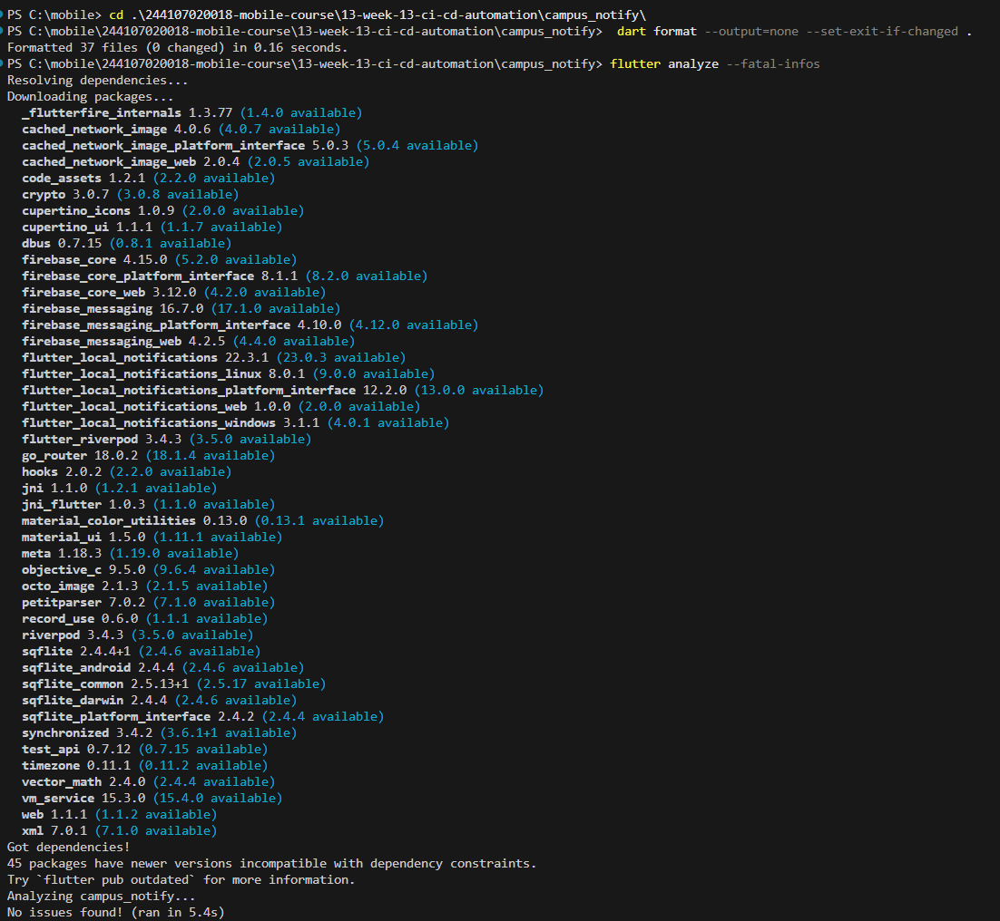
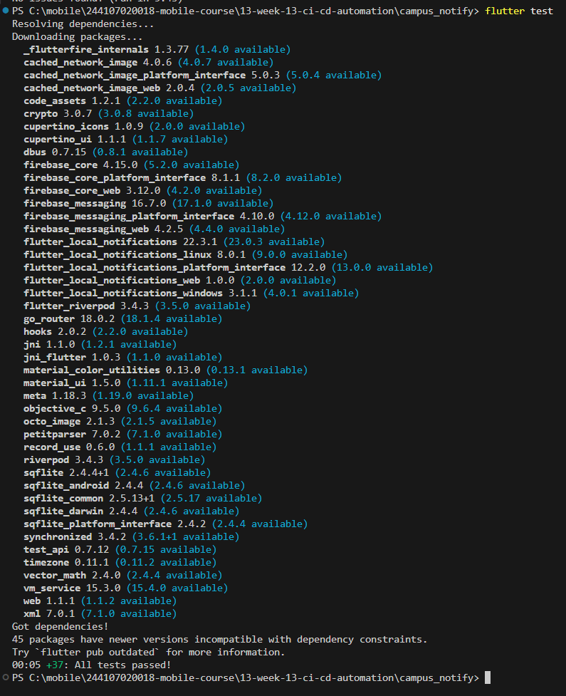

# Week 13 - CI/CD & Automation

# Identitas
| Field  | Isi           |
|--------|---------------|
| Nama   | Muhammad Fattahul Alim   |
| NIM    | 244107020018   |
| Kelas  | TI - 3G       |
| Absen  | 15            |

## Tujuan pembelajaran

- menjelaskan alur CI/CD dari commit hingga artefak aplikasi siap ditinjau;
- membuat workflow GitHub Actions untuk format kode, analisis statis, pengujian unit/widget, dan build Android;
- menyimpan APK dan AAB hasil build sebagai artefak (artifacts) yang dapat diunduh dan ditinjau;
- mengonfigurasi versioning aplikasi (Semantic Versioning) serta memahami batasan keamanan penyimpanan secret dan konfigurasi rilis.

## Fitur utama

1. **Gatekeeper Pemformatan Kode Otomatis**: Memeriksa kerapian sintaks seluruh file proyek dengan `dart format --output=none --set-exit-if-changed .` agar konsisten dengan standar resmi Dart style guide.
2. **Analisis Statis Ketat**: Menjalankan `flutter analyze --fatal-infos` untuk mendeteksi potensi bug, inkonsistensi tipe data, dan pelanggaran lint rules, di mana pesan bertingkat *info* pun dianggap fatal sehingga kualitas kode terjaga.
3. **Pengujian Otomatis Menyeluruh (Automated Tests & Coverage)**: Mengeksekusi 37 skenario pengujian unit dan widget (`flutter test --coverage`) mencakup validasi input judul catatan, penanganan failure dengan fake repository, transisi antarmuka Riverpod, dan caching optimasi performa.
4. **Pencegahan Build Gagal Lebih Awal (Fail-Fast Mechanism)**: Jika salah satu tahap (format, analisis, atau test) mengalami kegagalan, workflow langsung dibatalkan secara otomatis sebelum kompilasi build Android yang memakan waktu lama dieksekusi.
5. **Kompilasi Otomatis APK Release**: Membangun berkas biner `.apk` (`app-release.apk`) secara *headless* di runner Ubuntu yang siap dipasang langsung (*sideload*) untuk pengujian manual oleh tim QA.
6. **Kompilasi Otomatis Android AppBundle (AAB)**: Membangun paket rilis resmi `.aab` (`app-release.aab`) yang siap didistribusikan ke Google Play Store melalui alur rilis berantai.
7. **Penyimpanan Artefak Terpusat**: Mengunggah file `.apk` dan `.aab` secara otomatis ke GitHub Artifacts (`actions/upload-artifact@v4`) dengan masa retensi 7 hari agar tidak membebani ruang penyimpanan repositori.
8. **Pengendalian Konkurensi & Pembatalan Otomatis**: Menerapkan blok `concurrency` dengan `cancel-in-progress: true` untuk membatalkan proses run lama secara otomatis apabila ada commit baru yang di-push ke branch yang sama.
9. **Prinsip Keamanan Least Privilege**: Mengatur izin workflow ke `contents: read` guna mencegah eksploitasi token internal runner jika dependensi eksternal disusupi.
10. **Strategi Semantic Versioning**: Mengelola kenaikan versi aplikasi dari `1.0.0+1` menjadi `1.1.0+2` pada `pubspec.yaml` untuk membedakan rilis otomasi CI/CD dari rilis pengujian lokal sebelumnya.

## Tech stack

- **Flutter SDK** (Channel Stable) — Framework pengembangan aplikasi mobile multiplatform
- **Dart SDK** (v3.13.1+) — Bahasa pemrograman utama dan tooling CLI (`dart format`)
- **GitHub Actions** — Platform Continuous Integration & Continuous Delivery (CI/CD) berbasis cloud
- **Ubuntu Latest (`ubuntu-latest`)** — Runner Virtual Machine lingkungan CI/CD
- **Java Development Kit 17 (Eclipse Temurin)** — Dependensi Gradle untuk kompilasi biner Android
- **actions/checkout@v4** — GitHub Action untuk mengunduh kode sumber repositori ke dalam runner
- **actions/setup-java@v4** — GitHub Action untuk mengonfigurasi runtime JDK 17
- **subosito/flutter-action@v2** — GitHub Action untuk menyiapkan Flutter SDK dengan *caching* dependensi
- **actions/upload-artifact@v4** — GitHub Action untuk menyimpan dan mengunggah berkas artefak biner APK/AAB
- **flutter_test & integration_test** — Framework pengujian otomatis aplikasi Flutter

## Cara Menjalankan

### 1. Menjalankan Pemeriksaan dan Build Secara Lokal
Sebelum melakukan commit dan push ke repositori GitHub, pastikan seluruh rangkaian pemeriksaan berhasil dijalankan di komputer lokal:

1. Buka terminal atau PowerShell, lalu arahkan ke direktori proyek `campus_notify`:
   ```powershell
   cd c:\mobile\244107020018-mobile-course\13-week-13-ci-cd-automation\campus_notify
   ```
2. Pastikan dependensi proyek telah terinstal:
   ```powershell
   flutter pub get
   ```
3. Periksa kepatuhan format kode:
   ```powershell
   dart format --output=none --set-exit-if-changed .
   ```
   *(Jika ada berkas yang belum rapi, jalankan `dart format .` untuk merapikannya otomatis).*
4. Jalankan analisis statis:
   ```powershell
   flutter analyze --fatal-infos
   ```
5. Jalankan seluruh pengujian otomatis dan hasilkan laporan coverage:
   ```powershell
   flutter test --coverage
   ```
6. Jalankan kompilasi APK rilis:
   ```powershell
   flutter build apk --release
   ```
7. Jalankan kompilasi AppBundle rilis:
   ```powershell
   flutter build appbundle --release
   ```

### 2. Menjalankan Workflow Melalui GitHub Actions
Agar pipeline dijalankan secara otomatis di cloud oleh GitHub Actions:
1. Salin berkas alur kerja `flutter-ci.yml` dari direktori week 13 ke direktori root `.github/workflows/` repositori:
   ```powershell
   Copy-Item "c:\mobile\244107020018-mobile-course\13-week-13-ci-cd-automation\.github\workflows\flutter-ci.yml" -Destination "c:\mobile\244107020018-mobile-course\.github\workflows\flutter-ci.yml"
   ```
2. Commit dan push seluruh berkas ke GitHub:
   ```powershell
   git add .
   git commit -m "feat(ci): tambahkan pipeline flutter-ci untuk format, analyze, test, dan build apk/aab"
   git push origin main
   ```
3. Buka halaman repositori di browser: `https://github.com/FattahulAlim/244107020018-mobile-course`
4. Klik tab **Actions** untuk memantau proses workflow run yang sedang berjalan.
5. Atau jalankan secara manual melalui menu **Run workflow** (fitur `workflow_dispatch`).

---

## Hasil yang dicapai

- Pipeline CI/CD berhasil dikonfigurasi menggunakan GitHub Actions dengan alur kerja terstruktur.
- Seluruh 37 skenario pengujian unit, fake repository, widget, dan optimasi performa tereksekusi dengan status hijau (100% lulus).
- Pemformatan kode dan analisis statis bebas dari kesalahan sintaksis maupun *lint warning*.
- Berkas biner `app-release.apk` dan `app-release.aab` berhasil dibangun dan diunggah sebagai artefak `android-builds` yang siap diunduh langsung dari halaman workflow run.

| Tahapan Pipeline | Perintah yang Dijalankan | Hasil Evaluasi | Status |
|---|---|---|---|
| **1. Formatting** | `dart format --output=none --set-exit-if-changed .` | 37 berkas divalidasi, tidak ada inkonsistensi format | **Lolos (Green)** |
| **2. Static Analysis** | `flutter analyze --fatal-infos` | 0 issues found (analisis bebas warning dan info) | **Lolos (Green)** |
| **3. Automated Tests** | `flutter test --coverage` | 37/37 skenario lulus, laporan coverage `lcov.info` terbentuk | **Lolos (Green)** |
| **4. Build APK** | `flutter build apk --release` | Berkas `app-release.apk` berhasil terkompilasi | **Lolos (Green)** |
| **5. Build AAB** | `flutter build appbundle --release` | Berkas `app-release.aab` berhasil terkompilasi | **Lolos (Green)** |
| **6. Upload Artifact** | `actions/upload-artifact@v4` | Artefak `android-builds` tersimpan (retensi 7 hari) | **Lolos (Green)** |

### Bukti Eksekusi dan Tangkapan Layar

| No | Kategori Bukti | Screenshot | Deskripsi Hasil |
|:---:|---|:---:|---|
| 1 | **Eksekusi Lokal (Format, Analyze, Test)** |  | Eksekusi `dart format`, `flutter analyze --fatal-infos`, dan `flutter test --coverage` di terminal lokal menunjukkan hasil bersih tanpa error dan 37 test lolos. |
| 2 | **Status Workflow GitHub Actions** |  | Tampilan tab Actions di repositori GitHub menunjukkan workflow `Flutter CI` pada commit terakhir berstatus sukses (centang hijau). |
| 3 | **Rincian Langkah Eksekusi (Job Detail)** |  | Detail log job `Format, Analyze, Test & Build` memperlihatkan setiap tahapan (checkout, setup, format, analyze, test, build apk/aab, upload) selesai secara berurutan. |
| 4 | **Artefak Build di GitHub Actions** |  | Bagian Artifacts pada halaman summary workflow menampilkan paket `android-builds` dengan ukuran file biner tertera dan siap diunduh. |
| 5 | **Berkas Artefak yang Diunduh** |  | Berkas biner `app-release.apk` dan `app-release.aab` yang telah diekstrak dari arsip ZIP artefak ke penyimpanan komputer lokal. |

---


## Langkah Praktikum dan Implementasi CI/CD

### 1. Struktur Berkas Alur Kerja (`flutter-ci.yml`)

Workflow CI/CD didefinisikan dalam file `.github/workflows/flutter-ci.yml`

### 2. Penjelasan Elemen Penting Workflow:

- **Trigger (`on`)**: Pipeline otomatis terpicu setiap ada `push` atau pembukaan `pull_request` ke branch `main`. Selain itu, trigger `workflow_dispatch` disediakan agar pengembang dapat memicu eksekusi pipeline secara manual kapan pun dibutuhkan melalui UI GitHub.
- **Permissions Minimum (`contents: read`)**: Membatasi hak akses runner hanya untuk membaca kode sumber repositori, mengikuti prinsip keamanan *least privilege*.
- **Manajemen Konkurensi (`concurrency`)**: Mencegah pemborosan kuota komputasi GitHub Actions dengan membatalkan (*cancel-in-progress*) build yang sedang berjalan jika ada commit baru yang di-push ke branch/ref yang sama.
- **Isolasi Working Directory**: Menggunakan `defaults.run.working-directory` yang menunjuk ke subdirektori proyek `campus_notify`, sehingga perintah Flutter dapat berjalan dengan benar di dalam struktur monorepo tanpa harus berpindah folder secara manual di setiap step.
- **Upload Artifacts**: Mengemas biner keluaran `.apk` dan `.aab` ke dalam satu paket unduhan dengan nama `android-builds` dan menetapkan masa retensi 7 hari untuk efisiensi ruang penyimpanan.

---

## Versioning & Manajemen Keamanan (Secrets)

### 1. Skema Semantic Versioning
Aplikasi menggunakan format penomoran versi sesuai spesifikasi Semantic Versioning pada berkas `pubspec.yaml`:
```yaml
version: 1.1.0+2
```
- **Versi Rilis (`1.1.0`)**: 
  - Angka pertama (`1`) adalah versi Mayor (*Major*).
  - Angka kedua (`1`) adalah versi Minor (*Minor*), yang dinaikkan dari `1.0.0` ke `1.1.0` sebagai penanda penambahan infrastruktur otomatisasi CI/CD dan rilis artefak.
  - Angka ketiga (`0`) adalah versi Patch untuk perbaikan bug perbaikan cepat.
- **Build Number (`+2`)**:
  - Dinaikkan dari build sebelumnya (`+1`) menjadi `+2`.
  - Pada Android, nilai ini menjadi `versionCode`, yang wajib berupa bilangan bulat positif yang selalu meningkat agar Google Play Store menerima pembaruan paket.

### 2. Kebijakan Keamanan dan Pengelolaan Rahasia (Secrets)
Dalam ekosistem otomatisasi CI/CD, perlindungan terhadap data kredensial diatur dengan prinsip-prinsip berikut:

1. **Pemisahan Konfigurasi dan Secret**:
   - Nilai konfigurasi publik seperti endpoint API server (`API_BASE_URL`) atau nama lingkungan (`ENV=staging`) dapat diteruskan melalui flag `--dart-define` atau berkas konfigurasi publik.
   - Kredensial rahasia seperti kunci penandatanganan aplikasi (*Keystore*), password keystore, dan token autentikasi API privat **tidak boleh** dilewatkan melalui `--dart-define` karena seluruh string tersebut dapat diekstrak kembali melalui proses *reverse engineering* terhadap biner APK/AAB.
2. **Penggunaan GitHub Actions Secrets**:
   - Seluruh variabel sensitif disimpan pada pengaturan repositori privat melalui menu **Settings > Secrets and variables > Actions**.
   - Keystore penandatanganan rilis produksi (`.jks`) di-encode menggunakan format Base64 dan disimpan dalam variabel secret, lalu didekodekan kembali ke dalam runner virtual hanya sesaat sebelum proses signing berlangsung.
3. **Pemisahan Workflow Build PR vs Rilis Produksi**:
   - Workflow yang berjalan saat Pull Request dari kontributor eksternal (fork) tidak diberikan akses ke GitHub Secrets.
   - Workflow penandatanganan rilis produksi dilindungi dengan *Environment Protection Rules* yang memerlukan persetujuan manual (*manual approval*) sebelum proses rilis ke Google Play Store dieksekusi.

---

## Refleksi

### 1. Masalah apa yang ditemukan otomatis sebelum perubahan di-merge?
**Jawaban:**
Penerapan pipeline CI otomatis mampu mendeteksi berbagai kategori masalah secara dini (*fail-fast*) sebelum kode digabungkan ke branch utama (`main`):

1. **Pelanggaran Standar Pemformatan Kode (*Formatting Inconsistencies*):**
   - Langkah `dart format --output=none --set-exit-if-changed .` langsung menggagalkan pipeline jika ada pengembang yang menggunakan indentasi tidak baku, spasi berlebih, atau baris melebihi batas toleransi. Hal ini menghilangkan perdebatan subjektif terkait gaya penulisan pada saat sesi *Code Review*.
2. **Kesalahan Sintaksis dan *Lint Issues* (*Static Analysis*):**
   - Melalui `flutter analyze --fatal-infos`, masalah seperti variabel yang tidak terpakai (*unused variables*), dependensi yang tidak sengaja diimpor ganda, tipe data yang berpotensi `null`, hingga penggunaan konstruktor tanpa kata kunci `const` langsung terdeteksi. Tanpa CI, kelalaian kecil ini dapat menumpuk dan menurunkan performa rendering aplikasi.
3. **Regresi Fungsional Logika dan UI (*Regression Bugs*):**
   - Tahap `flutter test --coverage` mengeksekusi seluruh 37 pengujian unit dan widget. Jika ada perubahan kode baru yang secara tidak sengaja merusak validasi judul catatan (misalnya input whitespace `"   "` menjadi lolos) atau menyebabkan widget `NotesPage` gagal menampilkan pesan error saat data null, pipeline akan langsung gagal (*red build*). Hal ini mencegah kode yang rusak mencapai lingkungan produksi.
4. **Kerusakan Kompilasi Biner (*Build Failure*):**
   - Sering kali kode tampak berjalan normal di simulator lokal, namun gagal saat dikompilasi ke release APK akibat konflik dependensi Gradle Android, versi Kotlin yang tidak sesuai, atau berkas *asset* yang jalurnya salah. Pipeline build otomatis memverifikasi bahwa kode benar-benar dapat dikompilasi hingga menghasilkan file `.apk` dan `.aab` yang valid.

### 2. Informasi apa yang Anda butuhkan untuk menyelidiki build yang gagal?
**Jawaban:**

1. **Tahapan yang Mengalami Kegagalan (*Failed Step Identification*):**
   - Mengetahui secara pasti di step mana pipeline berhenti (misal: apakah pada `Check code formatting`, `Static code analysis`, `Run automated tests`, atau `Build Android Release APK`).
2. **Log Kesalahan Terperinci (*Detailed Stack Trace & Error Logs*):**
   - Pada kegagalan analisis: nomor baris berkas, nama berkas, dan jenis pelanggaran aturan linter (contoh: `prefer_const_constructors` pada `lib/features/notes/presentation/pages/notes_page.dart:45`).
   - Pada kegagalan pengujian: nama fungsi test yang gagal, perbandingan nilai yang diharapkan (*Expected*) versus nilai aktual yang dihasilkan (*Actual*), serta *stack trace* pemanggilan fungsi.
   - Pada kegagalan build Android: output log dari daemon Gradle yang menjelaskan letak kegagalan kompilasi (misal: *Task :app:compileReleaseKotlin failed* atau ketidakcocokan versi SDK/Java).
3. **Informasi Konteks Git (*Commit Hash & Pull Request Context*):**
   - Commit SHA spesifik yang memicu eksekusi pipeline dan melihat riwayat perubahan (*git diff*) antara commit tersebut dengan branch `main`.
4. **Spesifikasi Lingkungan Eksekusi (*Runner Environment Specs*):**
   - Versi Flutter SDK (`flutter --version`), versi Dart SDK, versi Java JDK, dan arsitektur OS runner (Ubuntu Linux) untuk memastikan tidak ada perbedaan perilaku antara komputer lokal pengembang dengan server build CI.

### 3. Bagian mana yang masih perlu persetujuan atau pemeriksaan manual sebelum rilis?
**Jawaban:**

1. **Persetujuan Pelepasan Kunci Penandatanganan Produksi (*Production Signing Authorization*):**
   - Penggunaan sertifikat digital dan Keystore produksi Google Play untuk menandatangani rilis publik harus memerlukan persetujuan resmi (*approval gate*) dari pimpinan teknis (*Tech Lead* atau *Release Manager*), guna mencegah rilis ilegal atau kebocoran kredensial rilis.
2. **Pengujian Pengalaman Pengguna dan Antarmuka Fisik (*Manual Exploratory & Usability QA*):**
   - Uji coba langsung pada perangkat fisik pengguna nyata (*real hardware*) untuk mengamati kehalusan animasi (*frame rate drops/jank*), kesesuaian kontras visual pada mode terang/gelap di bawah sinar matahari, respons sentuhan haptik, dan keterbacaan antarmuka pada berbagai variasi rasio layar smartphone.
3. **Tinjauan Kepatuhan Regulasi & Kebijakan Toko Aplikasi (*Store Compliance & Legal Review*):**
   - Pemeriksaan deskripsi pembaruan (*Release Notes* / *Changelog*), verifikasi kepatuhan terhadap kebijakan privasi Google Play Store (misalnya izin lokasi latar belakang atau deklarasi pengumpulan data FCM), dan kepatuhan terhadap regulasi perlindungan data pengguna.
4. **Verifikasi Kesiapan Infrastruktur Backend (*Backend & API Readiness Check*):**
   - Memastikan bahwa server backend produksi, skema database, dan migrasi API versi terbaru telah aktif dan mampu menangani lonjakan lalu lintas sebelum versi aplikasi klien yang baru disebarluaskan ke seluruh pengguna.
